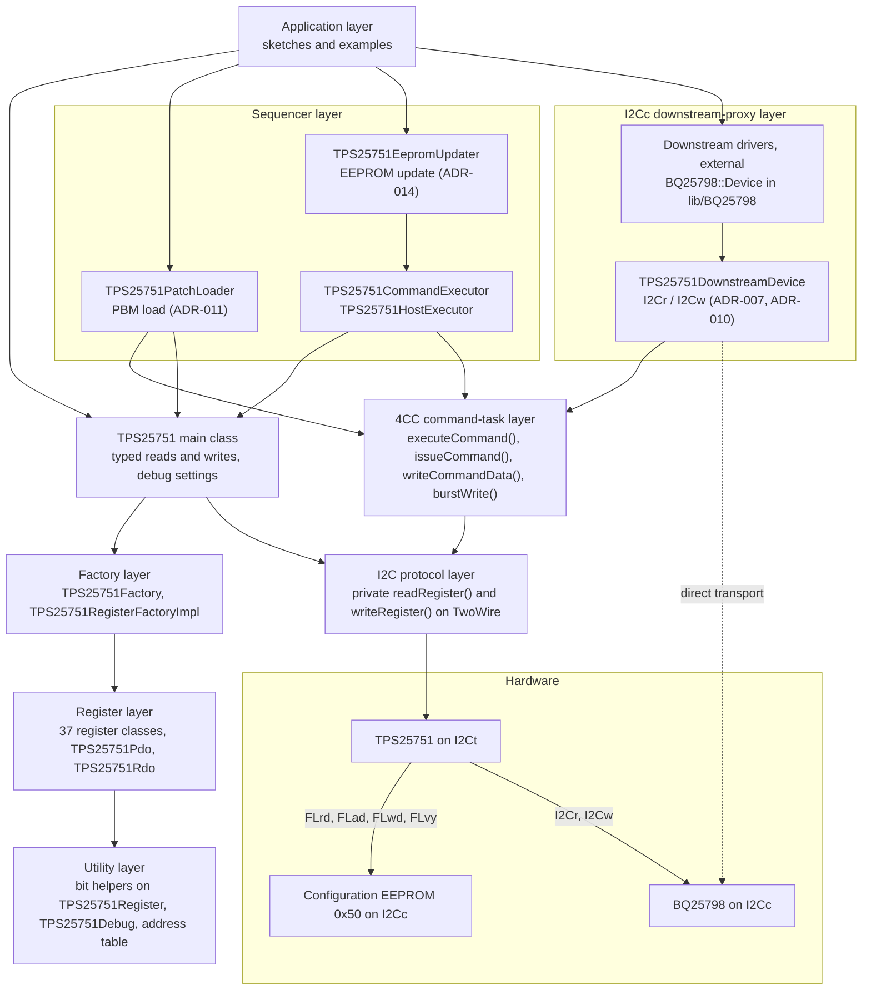
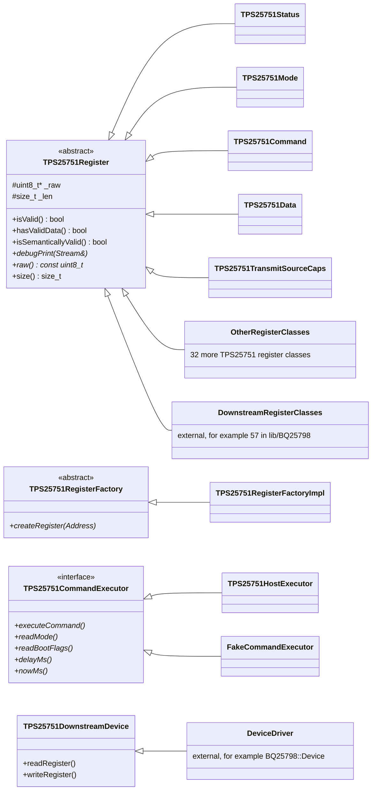
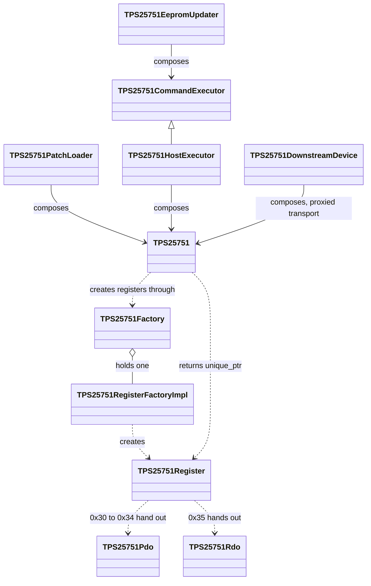
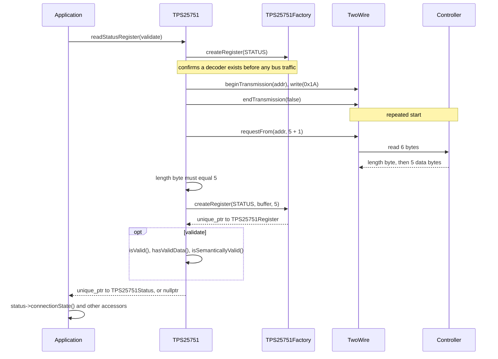
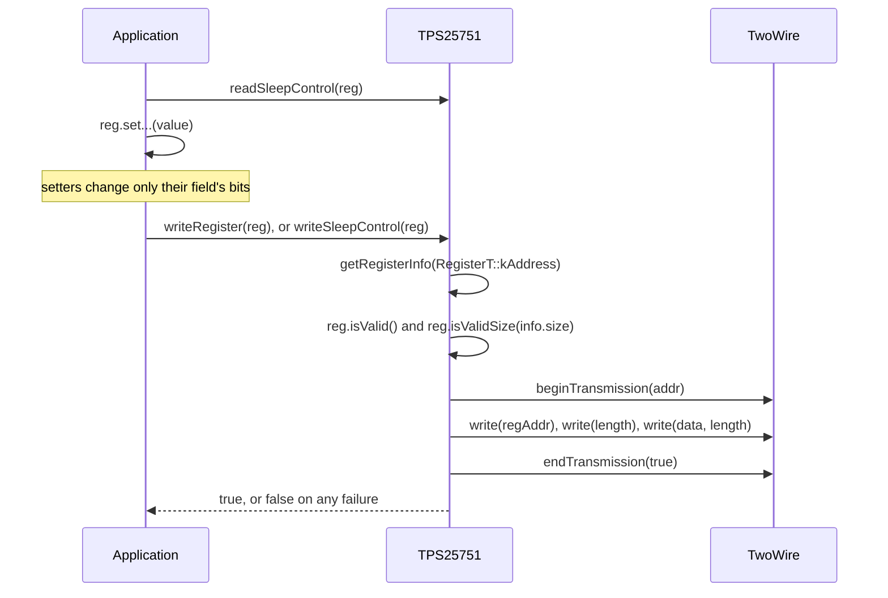
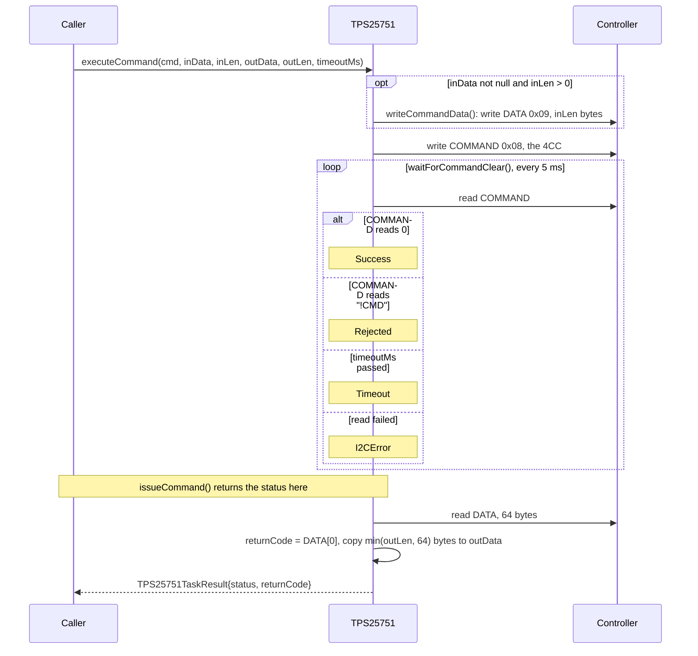
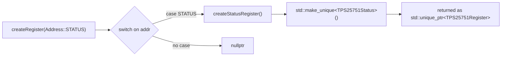
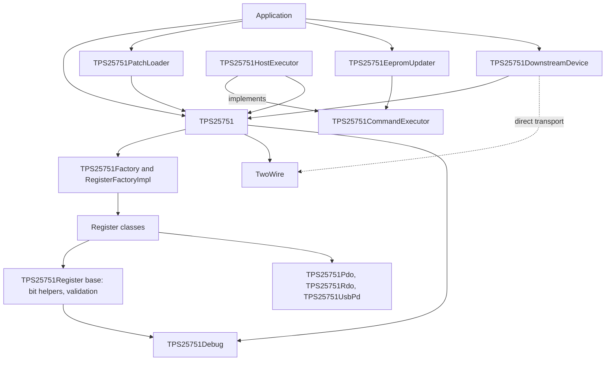
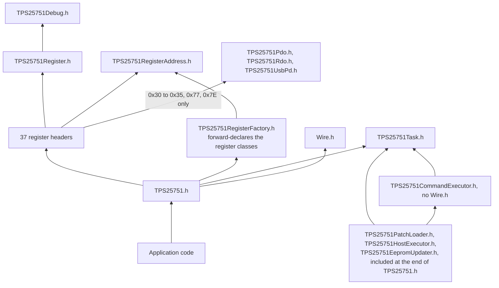

# TPS25751 Library - System Architecture

**Last Updated:** 2026-11-24
**Status:** Active

---

## Overview

This document describes how the TPS25751 library is built: its layers, its main classes,
the design patterns they follow, and how data moves through them. Read it before adding a
register class, a sequencer, or a downstream device driver. The Architectural Decision
Records at the end explain why the structure is the way it is; ADR-001 to ADR-003 are in
`AGENTS.md`.

The diagrams are Mermaid, which GitHub and most Markdown viewers render. Class and method
names in them match the headers in `include/`.

---

## Table of Contents

1. [System Overview](#system-overview)
2. [Component Architecture](#component-architecture)
3. [Design Patterns](#design-patterns)
4. [Class Hierarchy](#class-hierarchy)
5. [Data Flow](#data-flow)
6. [Extension Points](#extension-points)
7. [Component Relationships](#component-relationships)
8. [Memory Management Strategy](#memory-management-strategy)
9. [Testing Architecture](#testing-architecture)
10. [Future Architecture Considerations](#future-architecture-considerations)
11. [Architectural Decision Records](#architectural-decision-records)
12. [Revision History](#revision-history)

---

## System Overview

### High-Level Architecture

The application talks to one `TPS25751` object, or to a sequencer or downstream device
built on it. Everything that touches the bus goes through the `TPS25751` class's private
length-prefixed register transactions on a `TwoWire`, except the PBM burst, which
`burstWrite()` sends to I2C address 0x30. Devices on the controller's I2Cc bus, the
configuration EEPROM and the BQ25798 charger, are reached only through 4CC tasks that the
controller runs.



Solid arrows are calls or bus transactions; the dotted arrow is the optional direct
transport of ADR-010, which talks to a part on the MCU's own bus without the controller.
The 4CC layer is a set of methods on `TPS25751`, not a separate class; the diagram draws
it apart because three other components depend on it alone.

### Layer Responsibilities

#### Application layer

- User sketches and the three bundled examples: `read-registers`, `load-patch-bundle`, and
  `eeprom-update` (see `examples/README.md`).
- USB-C PD policy and any behavior specific to the product.

#### Main class (`TPS25751`)

- Owns the `TwoWire&` and the 7-bit I2Ct address (0x20 to 0x23, `TPS25751_I2CT_ADDRESS_IDX`).
- Typed reads in two forms: `read<Name>Register(bool validate = true)` returns a
  `std::unique_ptr` to the register class, or `nullptr` on a failed read or failed
  validation, and `read<Name>(T&)` fills a caller-owned object. All 37 registers have
  both. `readRegisterAs<T>(Address)` is the generic equivalent of the first form.
- One typed write per writable register (`writeSleepControl()`,
  `writeTransmitSourceCaps()`, and so on), plus the generic `writeRegister<T>(const T&)`
  keyed on the class's `kAddress`.
- Generic access by address: `readRegisterByAddress()`, `readRegisterAs<T>()`, and the
  `readRegister()` and `writeRegister()` overloads that take an `Address` or a
  `RegisterInfo`.
- Debug configuration: `setDebugStream()`, `setDebugLevel()`, `setDebugCategories()`.
- Errors are reported through `TPS_REPORT_I2C_ERROR` and `TPS_DEBUG_*` and returned as
  `false` or `nullptr`. The class does not retry; callers that need a retry, such as the
  patch loader's MODE poll, implement it.

#### 4CC command-task layer

- `TPS25751::writeCommandData()` writes DATA (0x09) at the input's own length, 1 to 64
  bytes.
- `TPS25751::issueCommand()` writes DATA, writes the 4CC to COMMAND (0x08), and polls
  COMMAND every 5 ms until it clears, reads `"!CMD"`, or the timeout passes (default
  200 ms). It reads no DATA.
- `TPS25751::executeCommand()` is `issueCommand()` followed by a read of all 64 DATA bytes;
  DATA byte 0 is the task's return code (TRM SLVUCR8B, 4CC Task Detailed Descriptions).
- `TPS25751::burstWrite()` sends raw chunks to the PBM receive address, 0x30, with no
  register number and no length byte (ADR-011).
- `TPS25751Command` and `TPS25751Data` decode the two registers; `TPS25751Task.h` holds the
  value types `TPS25751FourCC`, `TPS25751TaskStatus`, and `TPS25751TaskResult`.

#### Sequencer layer

- `TPS25751PatchLoader` loads a firmware and configuration image into a controller in PTCH
  through Patch Burst Mode, following SLVAFV8A and TRM Figure 5-1 (ADR-011).
- `TPS25751EepromUpdater` reads, updates, and blank-programs the configuration EEPROM
  through the `FLrd`, `FLad`, `FLwd`, and `FLvy` tasks, following SLVAFL1 (ADR-014).
- `TPS25751CommandExecutor` is the five-call interface the updater depends on;
  `TPS25751HostExecutor` adapts a `TPS25751` to it, and the native tests use
  `FakeCommandExecutor`.
- Neither sequencer is a register: neither inherits `TPS25751Register` nor appears in the
  factory.

#### I2Cc downstream-proxy layer

- `TPS25751DownstreamDevice` reads and writes registers of a part on the controller's I2Cc
  bus through the `I2Cr` and `I2Cw` tasks, encoding their DATA payloads (ADR-007). A second
  constructor selects a direct transport on a `TwoWire` instead (ADR-010).
- It composes a `const TPS25751&`; it is not a `TPS25751` subclass.
- It warns through `DEBUG_CAT_TASK` when two `I2Cr` or two `I2Cw` commands come less than
  5 s apart, the TRM's minimum spacing, but does not block them.

#### Downstream device driver tier (external)

- Typed per-device drivers inherit `TPS25751DownstreamDevice`, keep their own namespace,
  `Address` enum, and factory, and reuse `TPS25751Register` as their decoder base
  (ADR-008, ADR-009).
- The reference implementation is the BQ25798 charger driver (`BQ25798::Device`, 57
  register classes) in the sibling `lib/BQ25798` repository. It depends on this library;
  nothing here depends on it.

#### Factory layer

- `TPS25751RegisterFactory` is the abstract factory; `TPS25751RegisterFactoryImpl` creates
  one class per `TPS25751Registers::Address` and returns `nullptr` for an address without
  a decoder.
- `TPS25751Factory` holds the process-wide instance and lets tests replace it.
- `TPS25751RegisterCreator::create()` is a free-function shorthand for the same calls.

#### Register layer

- 37 register classes, one per register in TRM SLVUCR8B; `AGENTS.md` lists them with
  their addresses and decode notes.
- Field accessors decode from the raw bytes; R/W classes add setters built on `setBits()`
  and a `static constexpr kAddress`.
- Three validation tiers: `isValid()`, `hasValidData()`, and `isSemanticallyValid()`
  (ADR-005).
- `debugPrint(Stream&)` in the format of `STANDARDS.md`.
- USB PD objects decode through value types rather than per-register getters:
  `TPS25751Pdo`, `TPS25751Rdo`, and the `TPS25751UsbPd` namespace of data-block enums
  (ADR-013).

#### I2C protocol layer

- The private `TPS25751::readRegister(uint8_t, uint8_t*, size_t)` and
  `TPS25751::writeRegister(uint8_t, const uint8_t*, size_t)`: the controller's
  length-prefixed protocol on the injected `TwoWire`. See the Data Flow section.
- Every other access path in the library ends in these two methods, except `burstWrite()`
  and the direct transport of `TPS25751DownstreamDevice`.

#### Utility layer

- Bitfield helpers on `TPS25751Register`: `extractBits*()`, `extractEnum*()`, `setBits()`,
  with a 16-bit bit position (ADR-012).
- `TPS25751Debug`: leveled, categorized logging with a compile-time ceiling.
- `TPS25751RegisterAddress.h`: the `Address` enum, the `RegisterInfo` size table, and
  `getRegisterInfo()` and `getRegisterSize()`.

---

## Component Architecture

### Core Components

#### 1. TPS25751 Main Controller

Files: `include/TPS25751.h`, `src/TPS25751.cpp`. An excerpt of the public interface, one
example per group:

```cpp
class TPS25751 {
public:
    explicit TPS25751(TwoWire &wire = Wire, uint8_t address = TPS25751_I2CT_ADDRESS_IDX[0]);
    bool begin() const;

    // Typed reads: every register has both forms
    bool readStatus(TPS25751Status &statusOut) const;
    std::unique_ptr<TPS25751Status> readStatusRegister(bool validate = true) const;

    // Typed writes: one per writable register, and a generic one keyed on kAddress
    bool writeSleepControl(const TPS25751SleepControl &sleepControl) const;
    template<typename RegisterT> bool writeRegister(const RegisterT &reg) const;

    // Generic access by address
    std::unique_ptr<TPS25751Register> readRegisterByAddress(TPS25751Registers::Address addr) const;
    template<typename T> std::unique_ptr<T> readRegisterAs(TPS25751Registers::Address addr) const;
    bool readRegister(TPS25751Registers::Address addr, uint8_t *buffer, size_t length) const;
    bool writeRegister(TPS25751Registers::Address addr, const uint8_t *data, size_t length) const;

    // 4CC command tasks and the PBM burst
    bool writeCommandData(const uint8_t *data, size_t length) const;
    TPS25751TaskStatus issueCommand(TPS25751FourCC cmd, const uint8_t *inData, size_t inLen,
                                    uint32_t timeoutMs = 200) const;
    TPS25751TaskResult executeCommand(TPS25751FourCC cmd, const uint8_t *inData, size_t inLen,
                                      uint8_t *outData, size_t outLen,
                                      uint32_t timeoutMs = 200) const;
    bool burstWrite(uint8_t targetAddr, const uint8_t *data, size_t length,
                    size_t chunk = PBM_BURST_CHUNK, uint16_t interChunkDelayUs = 0) const;

    // Debug configuration
    static void setDebugLevel(uint8_t level);

private:
    TwoWire &_wire;
    uint8_t _address;
    bool readRegister(uint8_t regAddr, uint8_t *buffer, size_t length) const;
    bool writeRegister(uint8_t regAddr, const uint8_t *data, size_t length) const;
    TPS25751TaskStatus waitForCommandClear(uint32_t timeoutMs) const;
};
```

Every method is `const`: the object holds only the bus reference and the address, and all
device state lives in the controller. `TPS25751.h` includes every register header, the
factory, and `TPS25751Task.h`, and at its end `TPS25751PatchLoader.h`,
`TPS25751HostExecutor.h`, and `TPS25751EepromUpdater.h`, so one `#include` gives a sketch
the whole API.

#### 2. TPS25751Register Base Class

Files: `include/TPS25751Register.h`, `src/TPS25751Register.cpp`. The base owns the raw
bytes and supplies validation, bitfield, and debug helpers. It has no address of its own:
a register's identity is the `Address` it was created for, and an R/W class's `kAddress`.

```cpp
class TPS25751Register {
public:
    explicit TPS25751Register();
    explicit TPS25751Register(size_t len);           // zero-filled buffer of len bytes
    TPS25751Register(const uint8_t *data, size_t len);

    // Rule of Five: deep copy, move transfers the buffer
    TPS25751Register(const TPS25751Register& other);
    TPS25751Register& operator=(const TPS25751Register& other);
    TPS25751Register(TPS25751Register&& other) noexcept;
    TPS25751Register& operator=(TPS25751Register&& other) noexcept;
    virtual ~TPS25751Register();

    virtual void debugPrint(Stream &s = Serial) const = 0;

    // Validation tiers (ADR-005)
    bool isValid() const;                            // buffer present and non-empty
    bool hasValidData() const;                       // not all 0xFF
    virtual bool isSemanticallyValid() const;        // field rules; overridden per class
    bool isValidSize(size_t expectedSize) const;

    const uint8_t* raw() const;
    size_t size() const;

protected:
    uint8_t *_raw;
    size_t _len;
    // extractBits*(), extractEnum*(), setBits(): see the Utility Components section
};
```

The bitfield helpers are protected, and public in a native test build (`PIO_UNIT_TESTING`)
so the suites can call them directly.

#### 3. Concrete Register Classes

Each register class decodes one register. `TPS25751Status` (0x1A, 5 bytes) is the
reference:

```cpp
class TPS25751Status : public TPS25751Register {
public:
    explicit TPS25751Status() : TPS25751Register(TPS25751Registers::Registers::STATUS.size) {}
    explicit TPS25751Status(const uint8_t *data);
    TPS25751Status(const uint8_t *data, size_t len);

    bool plugPresent() const;
    ConnectionState connectionState() const;
    PortRole portRole() const;
    VbusStatus vbusStatus() const;
    // ... one accessor per field, enums with toString()

    void debugPrint(Stream &s = Serial) const override;
    bool isSemanticallyValid() const override;
};
```

The library has 37 register classes, one for each register in TRM SLVUCR8B. `AGENTS.md`
(Register Classes) lists them with their addresses, sizes, and decode notes; the factory
in `src/TPS25751RegisterFactory.cpp` is the authoritative mapping from address to class.
Read-only classes have accessors only. R/W classes add setters that call `setBits()` and a
`static constexpr TPS25751Registers::Address kAddress`, which `writeRegister<T>()` uses
so a class can be written only to its own register.

The six registers that carry USB PD PDOs and RDOs (0x30 to 0x35) hand out
`TPS25751Pdo` and `TPS25751Rdo` values instead of decoding the words themselves (ADR-013).

#### 4. Factory Pattern Implementation

Files: `include/TPS25751RegisterFactory.h`, `src/TPS25751RegisterFactory.cpp`.

Registers are identified by their hardware address. `TPS25751Registers::Address` in
`TPS25751RegisterAddress.h` is the single source of truth and the key the factory switches
on; there is no separate type enum.

```cpp
class TPS25751RegisterFactory {
public:
    virtual ~TPS25751RegisterFactory() = default;
    virtual std::unique_ptr<TPS25751Register> createRegister(TPS25751Registers::Address addr) = 0;
    virtual std::unique_ptr<TPS25751Register> createRegister(TPS25751Registers::Address addr,
                                                             const uint8_t* data, size_t length) = 0;
    virtual std::unique_ptr<TPS25751Register> createRegister(const TPS25751Registers::RegisterInfo& regInfo) = 0;
};

class TPS25751RegisterFactoryImpl : public TPS25751RegisterFactory {
    // Three createRegister() overrides, each a switch with one case per Address,
    // and two private creators per register:
    std::unique_ptr<TPS25751Register> createStatusRegister() const;
    std::unique_ptr<TPS25751Register> createStatusRegister(const uint8_t* data, size_t length) const;
    // ...
};

class TPS25751Factory {
public:
    static TPS25751RegisterFactory& getInstance();   // creates the Impl on first use
    static void setFactory(std::unique_ptr<TPS25751RegisterFactory> factory);
private:
    static std::unique_ptr<TPS25751RegisterFactory> instance_;
};

namespace TPS25751RegisterCreator {
    std::unique_ptr<TPS25751Register> create(TPS25751Registers::Address addr);
    // ... and the (addr, data, length) and RegisterInfo forms
}
```

An address without a decoder class returns `nullptr` from `createRegister()`; that is how
an undecoded register is reported.

#### 5. Utility Components

Bit helpers live on the register base class, not in a separate utility. Each has an
instance form that reads the register's own buffer and a static form that takes a buffer
and its length:

```cpp
// Bit n of a register is bit n % 8 of byte n / 8; multi-byte fields are little-endian.
uint8_t  extractBits  (uint16_t bitPos, uint8_t bitLen) const;  // 1..8 bits
uint16_t extractBits16(uint16_t bitPos, uint8_t bitLen) const;  // 1..16 bits
uint32_t extractBits32(uint16_t bitPos, uint8_t bitLen) const;  // 1..32 bits
uint64_t extractBits64(uint16_t bitPos, uint8_t bitLen) const;  // 1..64 bits
void     setBits      (uint16_t bitPos, uint8_t bitLen, uint32_t value);  // 1..32 bits
template<typename E> E extractEnum(uint16_t bitPos, uint8_t bitLen, uint8_t maxValidValue, E defaultValue) const;
// extractEnum16/32/64() take a wider maximum
static void printHex(Stream& s, uint32_t value, uint8_t digits);  // zero-padded hex for debugPrint()
```

The bit position is 16 bits (ADR-012), and a field outside the buffer reads 0 or is not
written. These helpers are the library's only bit-extraction API: the legacy
`include/util/TPS25751BitUtils.h` free function `extractBits(const uint8_t*, uint8_t,
uint8_t)`, with an 8-bit position and no bounds check, was removed on 2026-11-19.

`TPS25751Debug` is a namespace in `include/TPS25751Debug.h`:

```cpp
// Categories, combined as a bit mask
#define DEBUG_CAT_I2C         0x01  // I2C communication
#define DEBUG_CAT_REGISTER    0x02  // Register operations
#define DEBUG_CAT_VALIDATION  0x04  // Validation failures
#define DEBUG_CAT_PARSING     0x08  // Data parsing and extraction
#define DEBUG_CAT_TASK        0x10  // 4CC tasks, the downstream proxy, the sequencers
#define DEBUG_CAT_ALL         0xFF

// Levels
#define DEBUG_LEVEL_NONE   0
#define DEBUG_LEVEL_ERROR  1
#define DEBUG_LEVEL_WARN   2
#define DEBUG_LEVEL_INFO   3
#define DEBUG_LEVEL_DEBUG  4
#define DEBUG_LEVEL_TRACE  5

namespace TPS25751Debug {
    void setDebugStream(Stream* stream);
    void setDebugLevel(uint8_t level);
    void setDebugCategories(uint8_t categories);
    void enableCategory(uint8_t category);
    void disableCategory(uint8_t category);
    void hexDump(Stream& s, const uint8_t* data, size_t length, const char* prefix = nullptr);
    void debugPrint(uint8_t level, uint8_t category, const char* format, ...);
    void debugPrintF(uint8_t level, uint8_t category, const __FlashStringHelper* format, ...);
    void reportI2CError(uint8_t address, uint8_t registerAddr, const char* operation, int errorCode);
    void reportValidationError(const char* registerName, const char* validation, const char* details = nullptr);
}
```

Code logs through the `TPS_DEBUG_ERROR`, `TPS_DEBUG_WARN`, `TPS_DEBUG_INFO`, `TPS_DEBUG`,
`TPS_DEBUG_TRACE`, and `TPS_DEBUG_HEXDUMP` macros (with `_F` forms for flash strings) and
`TPS_REPORT_I2C_ERROR`, not by calling the namespace directly.

Compile-time and runtime control are independent:

- `DEBUG_LEVEL` is the runtime default, the initial value of
  `TPS25751Debug::currentDebugLevel` before `setDebugLevel()` is called. It defaults to
  `DEBUG_LEVEL_NONE`.
- `DEBUG_LEVEL_MAX` is the compile-time ceiling. The `TPS_DEBUG_*` macros are gated by
  `#if DEBUG_LEVEL_MAX >= <level>`; anything above the ceiling expands to nothing. It
  defaults to `DEBUG_LEVEL_TRACE`, so `setDebugLevel()` can enable any level with no build
  flag.

For a size-constrained build, lower the ceiling, for example
`-DDEBUG_LEVEL_MAX=DEBUG_LEVEL_NONE`. `setDebugLevel()` then cannot raise verbosity above
it, because that code is not in the binary. Before the split, `DEBUG_LEVEL` alone gated
compilation and defaulted to 0, so `setDebugLevel()` had no effect without
`-DDEBUG_LEVEL=5`.

#### 6. Command-Task and Sequencer Components

| Component | Files | Role |
|---|---|---|
| `TPS25751FourCC`, `TPS25751TaskStatus`, `TPS25751TaskResult` | `include/TPS25751Task.h` | A 4-character task code, the executor's outcome (`Success`, `Rejected`, `Timeout`, `I2CError`), and the outcome with DATA byte 0 |
| `TPS25751PatchLoader` | `include/TPS25751PatchLoader.h`, `src/TPS25751PatchLoader.cpp` | `loadPatchBundle(image, length)` runs the PBM flow and returns one `PatchLoadStatus` per failure point. Constructed with a `TPS25751&` and an optional IRQ pin |
| `TPS25751CommandExecutor` | `include/TPS25751CommandExecutor.h` | Interface: `executeCommand()`, `readMode()`, `readBootFlags()`, `delayMs()`, `nowMs()`. Does not include `Wire.h` |
| `TPS25751HostExecutor` | `include/TPS25751HostExecutor.h`, `src/TPS25751HostExecutor.cpp` | Forwards each call to a `TPS25751` and the Arduino clock |
| `TPS25751EepromUpdater` | `include/TPS25751EepromUpdater.h`, `src/TPS25751EepromUpdater.cpp` | Task primitives (`readFlash()`, `setWriteAddress()`, `writeData()`, `verifyBundle()`), checked region-pointer writes, `updateRegion()`, `updateInactiveRegion()`, `updateBothRegions()`, `programBlank()`, `compareRegion()`, `dump()`, and `coldReset()`. Returns `EepromUpdateStatus`; `lastStep()` names the step that failed |
| `TPS25751DownstreamDevice` | `include/TPS25751DownstreamDevice.h`, `src/TPS25751DownstreamDevice.cpp` | `readRegister()` and `writeRegister()` for a part on I2Cc, by proxy or direct transport |

---

## Design Patterns

### 1. Factory Method Pattern

Intent: create register objects by address without RTTI. The platform builds with
`-fno-rtti`, so neither `dynamic_cast` nor `typeid` is available (ADR-003).

```cpp
// Create by address, the single register identity
auto reg = TPS25751Factory::getInstance()
    .createRegister(TPS25751Registers::Address::STATUS);

// The address you asked for fixes the class, so static_cast is safe
if (reg) {
    auto* status = static_cast<TPS25751Status*>(reg.get());
}

// Or let the main class read, create, and cast in one call
auto status = tps.readRegisterAs<TPS25751Status>(TPS25751Registers::Address::STATUS);
```

The factory centralizes the address-to-class mapping, and a test can replace it through
`TPS25751Factory::setFactory()`.

### 2. Template Method Pattern

Intent: one validation sequence, with the field rules supplied per class. The base class
implements the first two tiers; each register overrides only the third.

```cpp
// TPS25751 runs the tiers in order (include/TPS25751.h)
template<typename T>
bool validateRegister(const T& reg) const {
    return reg.isValid() && reg.hasValidData() && reg.isSemanticallyValid();
}

// A register supplies its own rules
bool TPS25751Status::isSemanticallyValid() const {
    if (!isValid()) return false;
    // reserved bits, enum ranges, cross-field rules
    ...
}
```

`read<Name>Register(true)` and `readAndValidateRegister()` call `validateRegister()` and
return `nullptr` or `false` when a tier fails.

### 3. Singleton Pattern

Intent: one process-wide factory that tests can replace.

```cpp
TPS25751RegisterFactory& TPS25751Factory::getInstance() {
    if (!instance_) {
        instance_ = std::make_unique<TPS25751RegisterFactoryImpl>();
    }
    return *instance_;
}

void TPS25751Factory::setFactory(std::unique_ptr<TPS25751RegisterFactory> factory) {
    instance_ = std::move(factory);
}
```

The instance is created on first use. The library runs on a single thread, so the lazy
creation needs no lock.

### 4. RAII (Resource Acquisition Is Initialization)

Intent: no manual memory management in caller code. A register object allocates its
buffer with `new[]` in the constructor and frees it in the destructor; the Rule of Five
makes copies deep and moves transfer the pointer. Callers hold registers by value or in a
`std::unique_ptr`, so nothing leaks on an early return.

```cpp
TPS25751Register::TPS25751Register(const uint8_t *data, size_t len)
    : _raw(nullptr), _len(len)
{
    if (_len > 0) {
        _raw = new uint8_t[_len]();
    }
    if (data && _raw && _len > 0) {
        memcpy(_raw, data, _len);
    }
}
// ~TPS25751Register() releases _raw with delete[]
```

ADR-006 explains why the buffer is a raw array and not the `std::vector` first planned.

### 5. Three-Tier Validation

Intent: let the caller choose how much checking a read costs. The tiers are separate
methods, so a caller can stop at any of them:

| Tier | Method | Checks | Where implemented |
|---|---|---|---|
| Basic | `isValid()`, `isValidSize(n)` | A buffer is present, non-empty, and of the expected size | Base class |
| Data | `hasValidData()` | The bytes are not all 0xFF, the pattern of a bus with no device | Base class |
| Semantic | `isSemanticallyValid()` | Reserved bits, enum ranges, units, and cross-field rules from the TRM and USB PD R3.3 | Each register class |

Reading with `validate = false` skips all three; `validateRegister()` runs them in order.

### 6. Command-Executor Seam

Intent: test a sequencer on the host without `Wire`. `TPS25751EepromUpdater` calls a
`TPS25751CommandExecutor&` instead of a `TPS25751&`. On the target,
`TPS25751HostExecutor` forwards to a `TPS25751`; in the native tests,
`FakeCommandExecutor` models the EEPROM and can fail any task. Virtual calls need no RTTI
(ADR-014).

```cpp
TPS25751 pd(Wire);
TPS25751HostExecutor exec(pd);
TPS25751EepromUpdater updater(exec);
```

The patch loader and the downstream device take a `TPS25751` directly. Since the TwoWire
fake of 2026-11-23, `TPS25751.cpp` and the loader also build in `[env:native]`.

---

## Class Hierarchy

### Inheritance Tree



`FakeCommandExecutor` lives in `test/support/native/` and is not part of the library.
Classes that inherit nothing: `TPS25751`, `TPS25751Factory`, `TPS25751PatchLoader`,
`TPS25751EepromUpdater`, the value types `TPS25751Pdo` and `TPS25751Rdo`, and the
`TPS25751Task.h` structs.

`TPS25751Register` is a device-agnostic decoder base. Register classes for parts on the
I2Cc bus extend it exactly as host registers do. Each downstream device keeps its own
`Address` enum, `RegisterInfo` table, and factory, mirroring `TPS25751RegisterFactory` and
`TPS25751Factory`; the host factory is unaffected by them.

### Relationship Diagram



Composition everywhere above the main class: the sequencers and the downstream device each
hold a reference to the object they drive and never subclass it.

---

## Data Flow

### Register Read Flow

The controller answers a register read with a length byte followed by the data. The
library requests the register size plus one in a single read and checks the length byte
against the expected size.



A failed transaction, a short read, or a length byte that differs from the register size
ends the read with `TPS_REPORT_I2C_ERROR` and `nullptr`. The accessors decode through
`extractBits*()` on the object's own buffer and touch the bus no more.

### Register Write Flow

The write path sends the length byte instead of receiving it.



The other entry points join the same private `writeRegister(uint8_t, ...)`:
`writeRegister(Address, data, length)` first checks `length` against the register size
(0, an unknown address, skips the check), and `writeRegister(RegisterInfo, data)` takes the
size from the `RegisterInfo`. The library does not read a register back after writing it;
callers that need confirmation read it again, as the EEPROM updater does for its region
pointers.

### 4CC Command-Task Flow

`executeCommand()` is the generic executor (TRM SLVUCR8B, 4CC Task Detailed Descriptions).
`issueCommand()` is the same flow without the final DATA read, for a task whose DATA must
not be read at once (ADR-011 amendment of 2026-11-23).



DATA is written through `writeCommandData()` at the input's own length, not through the
public `writeRegister(Address, ...)`, which would require all 64 bytes. The executor knows
nothing about any task: `TPS25751DownstreamDevice`, `TPS25751PatchLoader`, and
`TPS25751HostExecutor` supply the payloads and unpack the results themselves, for example
I2Cr's read data, which starts at DATA byte 1 (CONSTRAINTS.md, 4CC Command Interface and
I2Cc Downstream-Device Proxy).

### Patch Load Flow

`TPS25751PatchLoader::loadPatchBundle()` loads an image into a controller in PTCH. The
step numbers are those of SLVAFV8A; `AGENTS.md` (Patch Loading) lists all 17, and ADR-011
records where the loader departs from TI's flow.


Every other failure returns its own `PatchLoadStatus` at the step where it happens.

### EEPROM Region Update Flow

`TPS25751EepromUpdater::updateRegion()` writes one region with the four steps of SLVAFL1
Figure 2-3, with a read-back added to step 2 (ADR-014). The header documents the state the
EEPROM is left in for every status.


`updateInactiveRegion()` picks the target with `selectTargetRegion()`, which reads the
region pointers first and BOOT_FLAGS only when both are valid. `updateBothRegions()` runs
the update twice, and `programBlank()` writes both AppConfigOffset words and then steps 1
to 3 for each region. `coldReset()` (`GAID`) is a separate call, so the application chooses
when the port disconnects.

### Downstream-Device Typed Write Flow (ADR-009)

The typed write tier of ADR-009 is a read-modify-write of a value object on the I2Cw
proxy: read the register through I2Cr, apply a field setter that changes only its own
bits, and write the whole buffer back through one I2Cw task (`len <= 11`,
`Length = payload + 1`; see ADR-007). The step-by-step walkthrough through the reference
implementation, `BQ25798::Device`, moved with the driver to the sibling `lib/BQ25798`
repository; see `docs/engineering/CONVENTIONS.md` there.

### Factory Creation Flow



The `(addr, data, length)` overload follows the same switch into the creator that copies
the bytes, and the `RegisterInfo` overload creates an empty object of the size the table
gives.

---

## Extension Points

### Adding a New Register Class

`STANDARDS.md` has the class template and `CONSTRAINTS.md` the platform rules. The steps:

1. Make sure the address is in `TPS25751Registers::Address` and has a `RegisterInfo` with
   its size and a `case` in `getRegisterInfo()` (`include/TPS25751RegisterAddress.h`). A
   missing case makes `readRegisterByAddress()` return `nullptr` for that register.
2. Create `include/TPS25751<Name>.h` and `src/TPS25751<Name>.cpp`, inheriting
   `TPS25751Register`: the constructors, field accessors, `isSemanticallyValid()`,
   `debugPrint()`, and for an R/W register setters on `setBits()` and `kAddress`.
3. Add a forward declaration and the two private creators to
   `include/TPS25751RegisterFactory.h`, and a `case` to each of the three
   `createRegister()` switches in `src/TPS25751RegisterFactory.cpp`.
4. Include the header in `include/TPS25751.h` and add `read<Name>()` and
   `read<Name>Register()`, and for an R/W register `write<Name>()`.
5. Add the source to `build_src_filter` of `[env:native]` in `platformio.ini`.
6. Add a suite `test/test_native/test_TPS25751<Name>/` with more than 90% line coverage of
   the new file (`TESTING.md`, `test/coverage.sh`).
7. Document with Doxygen (`DOCUMENTATION.md`) and add the class to `AGENTS.md`.

Extension points within a class: custom validation by overriding
`isSemanticallyValid()`, custom output by overriding `debugPrint()`, and any further
accessors the register needs.

### Adding a Downstream Device Driver

The BQ25798 driver (`BQ25798::Device`, in the sibling `lib/BQ25798` repository) is the
reference implementation; follow its layout. A driver is a separate library that depends
on this one and needs no change to any TPS25751 host file.

1. Create `include/<Device>/` and `src/<Device>/` for the device's headers and sources, and
   use a `namespace <Device>` throughout.
2. Define `<Device>::Registers::Address` and a `RegisterInfo` table, mirroring
   `TPS25751Registers` and `TPS25751RegisterAddress.h`.
3. Implement one register class per register under `include/<Device>/`, each inheriting
   `TPS25751Register`, with the same template as host registers: a default constructor and
   a `(const uint8_t*, size_t)` constructor, the three validation tiers, and `debugPrint()`
   with `F()`. Keep read-only registers decode-only; for R/W registers add a
   `static constexpr Registers::Address kAddress` and field setters following ADR-009.
   - Assemble a 16-bit register of a big-endian device as `(raw[0] << 8) | raw[1]`, not
     with `extractBits16()`, which is little-endian and would swap the bytes.
   - Reinterpret a signed ADC channel's assembled `uint16_t` as `int16_t`.
   - Take ADC LSB sizes from the device datasheet; the register-docs server may not carry
     conversion factors.
4. Create `<Device>::RegisterFactory`, `RegisterFactoryImpl`, and `Factory`, with the same
   abstract interface and singleton as the host, switching on `<Device>::Registers::Address`
   and returning `nullptr` for an unknown address.
5. Create `<Device>::Device : public TPS25751DownstreamDevice` in
   `include/<Device>/<Device>Device.h`, with one typed `read<Register>()` per register
   through the inherited `readRegister<T>()`. For writable registers add a generic
   `writeRegister<T>()` keyed on `T::kAddress`, an `updateRegister<T>()` read-modify-write
   helper, and optional convenience setters (ADR-009). Forward the `(TwoWire&, addr)`
   constructor to get the direct transport (ADR-010).
6. Respect the TRM's 5 s minimum spacing between consecutive I2Cr, or consecutive I2Cw,
   commands. `TPS25751DownstreamDevice` warns through `DEBUG_CAT_TASK` but does not block.
7. Define the device for the register-docs MCP server under `devices/<device>/` in the
   sibling `lib/device-register-mcp-server` repository, point an entry in the driver repo's
   `.mcp.json` at it (`uv --directory ../device-register-mcp-server run server.py`), and add
   it to the MCP table in the driver repo's `AGENTS.md`.

### Dependency Injection Points

```cpp
// Factory: replace the process-wide factory, for example in a test
TPS25751Factory::setFactory(std::make_unique<MyTestFactory>());
auto reg = TPS25751Factory::getInstance().createRegister(TPS25751Registers::Address::STATUS);

// Bus and address: any TwoWire and any of the four I2Ct addresses
TPS25751 pd(Wire1, TPS25751_I2CT_ADDRESS_IDX[1]);   // 0x21 on Wire1

// Command executor: the EEPROM updater runs on any TPS25751CommandExecutor
TPS25751HostExecutor exec(pd);
TPS25751EepromUpdater updater(exec);

// Downstream transport: proxied through the controller, or direct on a bus
TPS25751DownstreamDevice proxied(pd, 0x6B);
TPS25751DownstreamDevice direct(Wire2, 0x6B);
```

### Customization Points

```cpp
class MyRegister : public TPS25751Register {
public:
    bool isSemanticallyValid() const override {
        if (!isValid()) return false;
        return myFieldRulesHold();          // application-specific rules
    }

    void debugPrint(Stream &s = Serial) const override {
        // any format; STANDARDS.md defines the one the library uses
    }
};
```

---

## Component Relationships

### Module Dependencies



### Compile-Time Dependencies



The sequencer headers forward-declare `TPS25751` and are included at the end of
`TPS25751.h`, so an application needs one `#include` and the headers have no include
cycle. `TPS25751CommandExecutor.h` does not include `Wire.h`, which is what lets the
updater build on the host.

---

## Memory Management Strategy

### Ownership Model

The caller owns every register object the library returns:

```cpp
// Factory and main class hand over ownership in a unique_ptr
auto status = tps.readStatusRegister();
auto reg = TPS25751Factory::getInstance().createRegister(TPS25751Registers::Address::MODE);

// Or the caller supplies the object
TPS25751Status s;
tps.readStatus(s);
```

A register object owns its byte buffer (`uint8_t* _raw`, `size_t _len`), allocated with
`new[]` and freed in the destructor. `TPS25751` and the sequencers allocate nothing on the
heap for a transaction: their buffers, such as the 64-byte DATA image and the updater's
32-byte chunks, are on the stack. `readRegisterByAddress()` is the exception, with a
`std::make_unique<uint8_t[]>` scratch buffer that it frees on return.

### Move Semantics

The base class implements the Rule of Five. A move transfers `_raw` and leaves the source
empty (`isValid()` false); a copy allocates and copies. Register subclasses add no members
that own memory, so they use the base's copy and move operations and declare none of their
own.

```cpp
// unique_ptr<Derived> converts to unique_ptr<Base> without a copy
std::unique_ptr<TPS25751Register> TPS25751RegisterFactoryImpl::createStatusRegister() const {
    return std::make_unique<TPS25751Status>();
}

// A typed read assigns a temporary, so the buffer is moved, not copied
registerOut = RegisterT(buffer, regInfo.size);
```

---

## Testing Architecture

`TESTING.md` is the full description; this section shows how the tests attach to the
architecture.

### Unit Test Structure

The native tests run on the host with `pio test -e native` (Unity). There is one suite per
class under `test/test_native/test_TPS25751<Name>/`, plus `test_TPS25751Core` for the I2C
paths of `TPS25751`, `test_TPS25751RegisterAddress`, `test_TPS25751RegisterFactory`, and
`test_TPS25751Debug`. A register suite covers the constructors, every accessor and setter,
each validation tier, `debugPrint()`, and the factory case. `test/coverage.sh` reports line
coverage per file in `src/`; the target is more than 90% per file.

### Integration Test Structure

There is no automated integration test against a device. Integration is tested on
hardware with the example sketches, in the stages each feature plan defines, for example
the ten hardware stages of `docs/plans/feature/eeprom-update.md`. The verify gate builds
`example-read-registers` so a change that breaks a sketch is caught before merge.

### Mock Points

| Seam | Test double | Location |
|---|---|---|
| `TwoWire` | A Wire fake with a scriptable target and the Teensy driver's return codes | `test/support/native/Wire.h`, `FakeTps25751Target.h` |
| Arduino API | `millis()`, `delay()`, `micros()`, `Serial`, and `Stream` stubs with a controllable clock | `test/support/native/Arduino.h`, `Stream.h` |
| `TPS25751CommandExecutor` | `FakeCommandExecutor`, a modelled EEPROM with fault injection per task | `test/support/native/FakeCommandExecutor.h` |
| `TPS25751RegisterFactory` | Any subclass passed to `TPS25751Factory::setFactory()` | In the test |

`TPS25751DownstreamDevice.cpp` and `TPS25751HostExecutor.cpp` are not in the native build.

---

## Future Architecture Considerations

### Planned Enhancements

1. Interrupt-driven `executeCommand()` completion, deferred under ADR-007. An optional
   IRQ pin on `TPS25751` would let the executor wait for INT_EVENT1 bit 30 (Command 1
   Complete) instead of polling COMMAND, then read bit 82 (I2C Controller NACKed) and
   clear the event through INT_CLEAR1. `waitForCommandClear()` is a single private
   method so that a variant can replace it without touching DATA staging or any task's
   encoding. `TPS25751PatchLoader` already takes an IRQ pin for its Ready for Patch wait.
2. Additional platforms, ESP32 and RP2040 (`AGENTS.md`, Publishing the Library).
3. Moving `TPS25751PatchLoader` and `TPS25751DownstreamDevice` onto the
   `TPS25751CommandExecutor` seam. The EEPROM-update plan lists it as out of scope; the
   loader already has native tests through the Wire fake, so the gain is smaller than it
   was.

### Ideas Not Scheduled

These have no plan or owner. Each would change a guarantee the library makes today, which
is that a read always reflects the device at the time of the call.

- A cache of frequently read registers, invalidated on write or interrupt.
- Non-blocking register reads with a completion callback.
- Change notification for subscribed registers.
- Saving and restoring a set of register values as a profile.

---

## Architectural Decision Records

### ADR-004: Factory Pattern for Register Creation
**Status:** Accepted
**Decision:** Use Factory Method pattern instead of direct instantiation
**Rationale:**
- Platform has no RTTI, need type management
- Centralized creation logic
- Testable via dependency injection
**Consequences:**
- All register creation goes through factory
- Type safety without dynamic_cast
- Slightly more boilerplate for new types

### ADR-005: Three-Tier Validation
**Status:** Accepted
**Decision:** Separate validation into Basic, Data, Semantic levels
**Rationale:**
- Performance tuning (choose validation depth)
- Progressive validation strategy
- Clear separation of concerns
**Consequences:**
- Every register implements 3 validation methods
- Validation can be skipped in production if needed
- Better test coverage

Note, 2026-11-24: as built, the base class implements the first two tiers, `isValid()`
and `hasValidData()`, and each register overrides only the third,
`isSemanticallyValid()`. `TPS25751::validateRegister()` runs the three in order. See
Design Patterns, Three-Tier Validation.

### ADR-006: std::vector for Data Storage
**Status:** Superseded by the implementation; see the note below
**Decision:** Use std::vector<uint8_t> instead of raw arrays
**Rationale:**
- Automatic memory management
- RAII compliance
- Safe resizing
**Consequences:**
- Small heap overhead
- No manual memory management
- Exception-safe (if enabled)

Note, 2026-11-24: the code does not use `std::vector`. `TPS25751Register` holds a
`uint8_t* _raw` and a `size_t _len`, allocates with `new[]`, and implements the Rule of
Five, so ownership is still automatic for callers. The record does not say when or why
the decision changed. See Memory Management Strategy.

### ADR-007: 4CC Command-Task Layer + I2Cc Downstream-Device Proxy
**Status:** Accepted
**Date:** 2026-06
**Context:** The TPS25751 exposes most functionality as directly-addressed
registers, but reaches devices on its secondary I2Cc bus (e.g. a BQ25798
charger) only through a generic "4CC" command-task interface (COMMAND/DATA,
TRM Sec 4.4.2) — write a payload to DATA, write a 4-character task code to
COMMAND, poll for completion, read results back from DATA. The **I2Cr**/**I2Cw**
tasks are this interface's read/write proxy to the I2Cc bus.
**Decision:**
- Add a generic, task-agnostic executor (`TPS25751::executeCommand()`) on the
  host, plus `TPS25751Command`/`TPS25751Data` register classes wired into the
  existing factory like the other 15 registers then implemented.
- Add `TPS25751DownstreamDevice` as a *separate, composed* abstraction (not a
  `TPS25751Register` subclass, not part of `TPS25751RegisterFactory`) that
  encodes/decodes the I2Cr/I2Cw DATA payloads on top of `executeCommand()`.
- Downstream device register classes reuse the existing `TPS25751Register`
  decoder base, so they look and behave like host-side registers from the
  caller's perspective, without requiring a second factory. (ADR-008 later gave
  each downstream device driver its own factory.)
- Completion detection is a busy-poll of COMMAND every 5 ms with a 200 ms default
  timeout (`waitForCommandClear()`); an interrupt-driven variant is deferred (see
  Planned Enhancements) because the TRM's 5-second inter-command spacing is a
  separate constraint an IRQ does not eliminate — so async polling is a
  latency/CPU optimization, not a correctness fix, and isn't worth the
  ISR/INT_EVENT1/INT_CLEAR1 complexity until the I2Cc path is proven on
  hardware.
**Consequences:**
- The 4CC layer is generic — any future task code (not just I2Cr/I2Cw) can
  reuse `executeCommand()` directly.
- `TPS25751DownstreamDevice` must itself enforce the TRM's 5-second minimum
  spacing between consecutive same-type (I2Cr or I2Cw) commands; this is host
  pacing the executor cannot see, since it operates one task at a time.
- Adding a downstream device is cheaper than adding a TPS25751 register (no
  factory wiring), at the cost of not benefiting from the host's factory
  validation/dispatch machinery.

### ADR-008: Downstream-Device Driver Tier (BQ25798)
**Status:** Accepted
**Date:** 2026-06
**Note (2026-07):** The reference implementation (`BQ25798::Device`) now lives in
the sibling **`lib/BQ25798`** repository as a separate library depending on this
one. This ADR remains here because it defines the *extension-point contract* any
downstream driver must follow; the split itself validated the contract (the driver
moved out with zero source edits).
**Context:** `TPS25751DownstreamDevice` provides raw I2Cr/I2Cw proxy access, but
callers need typed, validated register objects for the BQ25798 charger — without
coupling the host TPS25751 factory to a third-party device.
**Decision:**
- The typed driver **inherits** `TPS25751DownstreamDevice` (e.g. `BQ25798::Device`)
  rather than composing it, so the driver is itself the proxy with zero extra
  indirection.
- All driver code lives in a dedicated `namespace <Device>` with its own directories
  (`include/<Device>/`, `src/<Device>/`), fully decoupled from the host namespace.
- Each downstream device maintains its own `Address` enum, `RegisterInfo` table, and
  factory (`<Device>::RegisterFactory` / `RegisterFactoryImpl` / `Factory` singleton),
  **mirroring the host-side pattern exactly**. The host factory is not modified.
- Downstream device register classes reuse `TPS25751Register` as their decoder base —
  they look and behave identically to host-side registers from the caller's
  perspective. Read-only registers stay decode-only; R/W registers also carry field
  setters and a `kAddress` for the typed write tier (see ADR-009).
- Writes go through the inherited `TPS25751DownstreamDevice::writeRegister()`, or
  driver-specific setter methods that validate and encode before calling it.
**Consequences:**
- Adding a new downstream device is self-contained: new directories + namespace +
  factory, no changes to any TPS25751 host files.
- **Big-endian 16-bit registers**: downstream devices (e.g. BQ25798) store 16-bit
  fields big-endian; assemble as `(raw[0] << 8) | raw[1]`, not via
  `extractBits16` (which is little-endian and silently byte-swaps the value).
- **Signed ADC channels** (IBUS, IBAT, TDIE on BQ25798): assembled uint16_t must be
  reinterpreted as `int16_t` (2's complement); treating as unsigned gives wrong sign.
- **ADC LSB step sizes** must be sourced from the device datasheet (SLUSE02 for
  BQ25798); the MCP register definitions do not carry conversion factors.
- The BQ25798 implementation (57 registers, sibling `lib/BQ25798` repo) is the
  canonical reference for future downstream device drivers.

### ADR-009: Downstream-Device Write Encoders
**Status:** Accepted
**Date:** 2026-06
**Context:** ADR-008 established the decode (read) tier for downstream devices and
left field-level encoders deferred. Callers now need to *write* the ~31 R/W BQ25798
registers (charge/voltage/current limits, enables, watchdog, …) with the same typed,
field-level ergonomics as the read tier — without re-reading-and-clobbering reserved
or sibling bits.
**Decision:**
- **Read-modify-write value-object model.** A register object owns its raw bytes
  (`TPS25751Register::raw()` / `size()`, exposed on the base for this purpose). A field
  setter mutates only its field's bits in that buffer; everything else (reserved bits,
  sibling fields) is preserved by construction. The whole buffer is then written back.
- **Encode helpers** (`include/BQ25798/BQ25798Encode.h`, `lib/BQ25798` repo): `setField8()` and
  `setField16BE()` are the inverse of the decode-side extraction. They read-modify-write
  only the field's bits and mask the value to the field width. `setField16BE()` is
  **big-endian** (`raw[0]=MSB`), matching the read side's `(raw[0]<<8)|raw[1]`.
- **Generic typed write** — `Device::writeRegister<T>(const T&)` keys on the register's
  `static constexpr T::kAddress` (the single source of register identity) and sends
  `reg.raw()/reg.size()` through the inherited raw I2Cw path. A
  `using TPS25751DownstreamDevice::writeRegister;` keeps the inherited raw overload
  visible alongside the template.
- **`Device::updateRegister<T>(Fn&& mutate)`** — read `T` live, apply the mutator, write
  it back; one-call read-modify-write. The 10 L3 convenience setters
  (`enableCharging`, `setChargeCurrentLimit`, …) are thin `updateRegister<T>` wrappers.
- **Field setters invert the class's *own* decode constants.** An engineering-unit
  setter (e.g. `setMillivolts`) reuses the same `kLsbMv`/`kOffsetMv` the decode accessor
  uses, so encode and decode can never disagree. Offset conversions guard against
  unsigned underflow (clamp to 0 below the offset). Every setter is guarded
  `if (!isValid()) return;`.
**Consequences:**
- Reserved bits are preserved automatically — there is no separate "reassemble the whole
  register" step that could drop or zero them.
- Cross-references ADR-008 (decode tier): the same big-endian and own-constant rules now
  apply symmetrically on encode. The I2Cw framing constraints (`len ≤ 11`,
  `Length = payload + 1`) from ADR-007 are unchanged and apply to typed writes.
- Read-only registers (Status, Flags, ADC results, IcoCurrentLimit, PartInfo) get no
  `kAddress` and no setters, so they cannot be written by mistake.
- Canonical examples (sibling `lib/BQ25798` repo): `BQ25798ChargerControl0`
  (single-bit), `BQ25798ChargeVoltageLimit` (16-bit BE + unit inversion),
  `BQ25798MinimalSystemVoltage` (offset inversion with underflow guard).

### ADR-010: Dual-Transport Downstream Devices — Optional Direct I2C
**Status:** Accepted
**Date:** 2026-06
**Context:** `TPS25751DownstreamDevice` (and thus `BQ25798::Device`) could only reach a
part *through* the TPS25751, encoding every access as an I2Cr/I2Cw 4CC task (ADR-007).
That is correct for the production topology (charger on the TPS25751's I2Cc bus) but
unusable for bench bring-up, validation, or boards where the part is wired straight to
the MCU's own I2C bus. The TRM 5 s spacing and the 63-byte read / 11-byte write payload
caps are artifacts of the proxy path, not of the part.
**Decision:**
- **Transport is selected at construction, branched at one chokepoint.** A second
  constructor `TPS25751DownstreamDevice(TwoWire&, addr)` selects a **direct** transport;
  the existing `(const TPS25751&, addr)` constructor keeps the **proxied** transport. The
  host member becomes a nullable `const TPS25751*` and a `TwoWire*` is added; a `_direct`
  flag picks the path. The two raw methods `readRegister()` / `writeRegister()` branch to
  `readDirect`/`writeDirect` (plain Arduino-`Wire` register transactions) or
  `readProxied`/`writeProxied` (the unchanged I2Cr/I2Cw bodies).
- **Everything above the chokepoint is untouched.** All 50+ `BQ25798::Device` typed
  accessors, the generic `writeRegister<T>`/`updateRegister<T>`, and the L3 setters funnel
  through those two raw methods, so they work identically in either transport with no code
  change. `BQ25798::Device` just gains a forwarding `Device(TwoWire&, addr)` constructor.
- **Direct mode is standard I2C.** Read = write register pointer, repeated-start,
  burst-read N bytes (the part auto-increments its pointer); write = register pointer +
  payload + STOP. This is the part's own protocol, *not* the TPS25751's length-byte
  register protocol and *not* the 4CC task path.

**Consequences:**
- Direct mode has **no** TRM 5 s spacing and **no** 63/11-byte caps — the only bound is
  the `TwoWire` buffer. It requires the part to actually be on the passed bus.
- Any future downstream-device driver built on `TPS25751DownstreamDevice` inherits direct
  mode for free.
- The big-endian decode/encode conventions (ADR-008/009) are unchanged: burst reads/writes
  carry multi-byte registers identically over either transport.

### ADR-011: Patch Loader — Non-Register PBM Sequencer on `executeCommand()`
**Status:** Accepted
**Date:** 2026-06
**Context:** The TPS25751 can boot in PTCH (patch) mode when no EEPROM is present and
receive its firmware+configuration image directly over I2Ct via Patch Burst Mode (PBM),
documented in TI app note SLVAFV8A.  The PBM flow uses two 4CC command-tasks (`PBMs`
to start the session, `PBMc` to commit it) plus a raw burst write to I2C address `0x30`
(no register number, no length byte — unlike every other TPS25751 write).
**Decision:**
- **`TPS25751PatchLoader` is not a register.** The PBM flow has no fixed register layout
  and does not benefit from the factory / three-tier validation machinery. The loader
  deliberately does not inherit `TPS25751Register` and is not wired into
  `TPS25751RegisterFactory`. Reviewers should not expect the register-class template.
- **Reuse `executeCommand()` for both 4CC commands.** `PBMs` and `PBMc` are submitted
  via `TPS25751::executeCommand()` like any other task; DATA staging, COMMAND write,
  COMMAND polling, `"!CMD"` detection, and DATA read-back are all handled by the executor.
  The loader supplies only the payload bytes and maps `TPS25751TaskResult` to
  `PatchLoadStatus`.
- **One new core primitive: `TPS25751::burstWrite()`.** The raw burst to `0x30` (no
  register number, no length byte) is the only I2C access shape `executeCommand()` cannot
  cover. It is implemented as a public method on `TPS25751`, loops
  `beginTransmission/write/endTransmission(true)` per chunk of `min(chunk, remaining)`
  bytes, and reuses `TPS_DEBUG_*` / `TPS_REPORT_I2C_ERROR` exactly like `writeRegister`.
  The default chunk size is `PBM_BURST_CHUNK` (32 bytes, matching the stock Wire TX
  buffer); the PBM pointer auto-increments across I2C START/STOP so chunking is safe
  (SLVAFV8A footnote 3).
- **`PatchLoadStatus` provides one distinct value per failure point** in the 17-step
  sequence, giving callers a precise diagnostic rather than a boolean.
- **IRQ-gated inter-command waiting is optional** (`irqPin = -1` defaults to pure
  polling). Command-completion polling is always done by `executeCommand()`'s internal
  `waitForCommandClear()`; the IRQ pin is used only for the "Ready-for-Patch" step 1
  signal, which the polling mode skips.
**Consequences:**
- `TPS25751PatchLoader` is a standalone sequencer (`include/TPS25751PatchLoader.h`,
  `src/TPS25751PatchLoader.cpp`) that composes a `TPS25751&` reference. It forward-
  declares `TPS25751` in its header to avoid a circular include (TPS25751.h includes
  TPS25751PatchLoader.h at its end for transparent consumer access).
- The `0x30` argument to `burstWrite()` is a 7-bit I2C *device address* (the PBM receive
  port), not a TPS25751 register offset — these happen to share the numeric value with
  `TPS25751Registers::Address::RECEIVED_SOURCE_CAPABILITIES` but are entirely unrelated.
- The `bundleSize` field of the `PBMs` configuration is **little-endian** (4 bytes, LSB
  first), consistent with host-register byte order and opposite to the BQ25798 downstream
  registers, which are big-endian. See CONSTRAINTS.md "Patch Burst Mode (PBM)".

Amendment, 2026-11-23: `PBMc` no longer goes through `executeCommand()`, which reads
DATA the instant COMMAND clears. SLVAFV8A (step 15, page 11, and its code on page 18) and
TRM Figure 5-1 (page 88) wait 20 ms between `PBMc` completing and the DATA read. In hardware
stage 5 of the EEPROM-update plan, on one board, that immediate read returned 28 of 65
bytes and the load reported `I2cError` although the patch had loaded; every later read
from the host failed with error 2, for a cause not established on either side of the bus.
- `TPS25751::issueCommand()` writes DATA and COMMAND and waits for COMMAND to clear or
  read "!CMD", without reading DATA. `executeCommand()` is `issueCommand()` plus the DATA
  read, with the same transactions as before. `PBMs` keeps `executeCommand()`, because
  SLVAFV8A reads its DATA right after the clear (steps 8 and 9, pages 9 and 10).
- After `PBMc` the loader waits `PATCH_APPLY_DELAY_MS` (20 ms), reads DATA with a retry
  every 10 ms for up to `PBM_DATA_READ_CAP_MS`, then polls MODE every 10 ms for up to
  `PBM_MODE_POLL_CAP_MS` until APP, tolerating failed reads. Both caps are 5000 ms, a
  choice the documents do not bound. The INT_EVENT1.PatchLoaded poll of Figure 5-1 is not
  used; SLVAFV8A goes from DATA to MODE without it.
- `TPS25751.cpp` and `TPS25751PatchLoader.cpp` now build in `[env:native]` against a
  TwoWire fake, and `test_TPS25751PatchLoader` pins the transaction order and the 20 ms.
  Hardware stages 6 and 7 of the EEPROM-update plan ran this sequence in ten loads, all
  Success, with every later read acknowledged.

Amendment, 2026-11-24: three more steps follow TRM Figure 5-1 (page 88) and SLVAFV8A,
by the user's decision recorded in the EEPROM-update plan.
- Step 1 in polling mode polls INT_EVENT1 bit 81 (Ready for Patch) every 10 ms for up to
  5 s, so the IRQ pin is no longer the only ready signal. Step 2 polls MODE every 10 ms
  for up to 5 s until PTCH, in both modes.
- The `PBMs` configuration is staged with the new `TPS25751::writeCommandData()`, read
  back 500 µs later, and compared, for up to 3 attempts; `PBMs` then goes through
  `executeCommand()` with no input. The loader now uses the core class for one more
  primitive, an exact-length DATA write, which `issueCommand()` also uses.
- After a burst chunk that is not acknowledged, or "!CMD" on `PBMc`, the loader issues
  `PBMe` through `executeCommand()` and still returns `BurstFailed` or `PbmcRejected`.
- `PatchLoadStatus::PbmsConfigMismatch` is appended after `I2cError`, so the earlier
  values keep their numbers. Hardware stage 8 of the EEPROM-update plan (2026-11-24) ran
  steps 1, 2, and 5 in five loads, all Success; neither `PBMe` path has run on hardware.


### ADR-012: 16-Bit Bit Positions in the Register Base Class
**Status:** Accepted
**Date:** 2026-11-19
**Context:** `extractBits()`, `extractBits16/32/64()`, `setBits()`, and the `extractEnum*()`
templates took the field's bit position as `uint8_t`, so no field could start past bit 255
(byte 31). Seven registers are longer than 32 bytes. DATA (0x09) and the four capability
registers (0x30 to 0x33) reach their late bytes through byte accessors or hand-assembled PDO
words, and two registers with individually defined fields past bit 255 worked around the
limit on their own: IO_CONFIG (0x5C, 49 bytes, fields to bit 391) and
TX_BATTERY_CAPABILITIES (0x7D, 36 bytes, battery 3 at bits 287:216).
`TPS25751IOConfig` assembled every field from `_raw[]` by hand, and
`TPS25751TransmitBatteryCapabilities` carried four class-private, bounds-checked byte
helpers for reads and writes. Both copies repeated bounds logic the base class already
has, and every new long register would have added another.
**Decision:**
- Widen `bitPos` to `uint16_t` in every instance and static extract and set method and in
  the `extractEnum*()` templates. `bitLen` stays `uint8_t`, because no field is wider than
  64 bits.
- Do all internal byte arithmetic (start byte, bytes needed, loop indexes) in `size_t`, and
  compare the field's end against the buffer length in `size_t`, so no sum can wrap.
  `extractBits64()` computes the upper half's bit position in 32 bits and reads that half
  as 0 when the position does not fit, instead of letting it wrap to a low bit. Each half
  stays bounds-checked on its own, as before.
- Convert 0x7D and 0x5C to the base-class calls and delete their private helpers.
- `uint16_t` rather than `size_t`: 65,535 bits is 8 KB, far past the 64-byte DATA register,
  and it matches the existing `uint16_t startBitPos` of `extractArray32()`.
**Consequences:**
- Any field inside the buffer is reachable; the only limit is the register's length.
- The change is source-compatible. Callers pass integer literals or `uint8_t` values, which
  convert implicitly, including the sibling BQ25798 driver, which calls the protected
  helpers. A derived class that declares its own `extractBits(uint8_t, uint8_t)` overload
  would now overload rather than hide the base method; no class in this repository or in
  BQ25798 does.
- Decode results do not change. Native tests cover fields at bit 255, past it, and
  straddling it, and a byte-for-byte comparison of `debugPrint()` for all 37 registers
  matched before and after.
- The PDO accessors of the capability registers (0x30 to 0x33) still assemble their 32-bit
  words from `_raw[]` by hand. They are correct and were left as they are; they could move
  to `extractBits32()` and `setBits()` in a later cleanup.


### ADR-013: USB PD Objects as Value Types
**Status:** Accepted
**Date:** 2026-11-22
**Context:** Registers 0x30 to 0x35 carry USB PD PDO and RDO words. Each class decoded
them with its own getters (`getFixedVoltage_mV(i)`, `fixedUnconstrainedPower()`,
`operatingCurrent_mA()`, and so on), so five copies of the PDO decode drifted apart and
shared the same faults: fixed-PDO flags read from any position although Table 6.10
reserves them outside PDO 1, no decode of the SPR AVS APDO the board itself
advertises, every RDO read as Fixed/Variable whatever the contract, and per-class
validation rules that disagreed with the specification.
**Decision:**
- One value type per object: `TPS25751Pdo` (a PDO word, its 1-based position, and the
  role of its sender) and `TPS25751Rdo` (an RDO word and its `RdoKind`). Both decode
  from USB PD R3.3 V1.0 tables served by `usb-pd-docs`, return 0 or false for a field
  that does not apply, and print themselves.
- The register classes hand them out: `pdo(i)` in 0x30 to 0x33, `activePdo()` and
  `firstPdoControl()` in 0x34, `ownRdo(kind)` and `requestedRdo(kind)` in 0x35. The
  per-class field getters are removed.
- An RDO's kind is not in the word. The caller derives it with `rdoKindFor(pdo)` from
  the PDO at the RDO's Object Position, and 0x35 offers a `debugPrint()` overload that
  takes both kinds.
- `validatePdoList()` validates a whole Capabilities list once, with the received or
  transmit rule set, so a list rule (PDO 1 is vSafe5V, the PDO order, AVS currents
  matching the Fixed PDOs) has one implementation.
**Consequences:**
- A breaking API change in 3.0.0: the per-class PDO and RDO getters are gone, and
  0x34's raw accessors are renamed `rawActivePdo()` and `rawFirstPdoControlBits()`.
- Decoding a new PDO or RDO layout, or changing a rule, is a change to one file and
  one suite (`test_TPS25751Pdo`, `test_TPS25751Rdo`).
- 0x30 to 0x34 validation follows USB PD R3.3 (received lists reject only what a
  receiver must; transmit lists also enforce the sender rules), which accepts some
  values the old rules rejected (zero currents) and rejects some they accepted (a PDO
  1 at 4.9 V, an over-range current).
- 0x35 cannot decode its typed fields alone; its single-argument `debugPrint()` prints
  the raw words and common fields with a note that the typed fields need the PDO type.

### ADR-014: EEPROM Updater, a Non-Register Flash-Task Sequencer on an Executor Seam
**Status:** Accepted
**Date:** 2026-11-23
**Context:** The TPS25751 boots its patch bundle from an external EEPROM at 0x50 on its
I2Cc bus. A host on I2Ct rewrites that EEPROM only through four flash 4CC tasks, `FLrd`,
`FLad`, `FLwd`, and `FLvy` (TRM SLVUCR8B Tables 4-19 to 4-22, pages 81 and 82), while the
controller runs in APP. TI application note SLVAFL1 defines a two-region layout and a
four-step update in which an erased region pointer keeps the controller from loading a
region while it is written. An ordering error can leave no bootable region; recovery then
needs a PBM load (ADR-011) or an external programmer. The sequencing therefore needs
host-run tests that inject a fault at every task, and `src/TPS25751.cpp`, which owns
`executeCommand()`, could not run on the host because it needs `Wire`. (The TwoWire fake
added the same day for the ADR-011 amendment later brought `TPS25751.cpp` into
`[env:native]`; the seam stays, because a fake executor models the EEPROM far more simply
than a fake bus.)
**Decision:**
- `TPS25751EepromUpdater` is a sequencer, not a register, beside `TPS25751PatchLoader`: it
  does not inherit `TPS25751Register` and is not in the factory. It provides the task
  primitives, checked region pointer writes, `updateRegion()`, `updateInactiveRegion()`,
  `updateBothRegions()`, `programBlank()`, `compareRegion()`, `dump()`, and `coldReset()`.
- It depends on `TPS25751CommandExecutor`, an interface of five calls (`executeCommand()`,
  `readMode()`, `readBootFlags()`, `delayMs()`, `nowMs()`) that does not include `Wire.h`.
  `TPS25751HostExecutor` adapts a `TPS25751` to it on the target, and the native tests use
  `FakeCommandExecutor`. Virtual calls need no RTTI, so the `-fno-rtti` constraint holds.
  `TPS25751` itself is unchanged.
- A region counts as bootable only if its pointer equals its bundle start and its
  AppConfigOffset word reads 0, because the controller looks for the Header_ID at the
  region start plus that word (SLVAFL1 page 2; decided 2026-11-23). The pre-flight of
  `updateRegion()` requires the kept region to be bootable (`NoBootableRegion`) and the
  target's word to read 0 (`AppConfigOffsetNotZero`), and step 3 reads the target's word
  once more before the pointer write. `updateRegion()` does not write the word; a region
  behind another value is repaired by erasing both pointers and running `programBlank()`.
- Region selection reads the pointers first and BOOT_FLAGS (0x2D, BOOT_STATUS in SLVAFL1)
  second, and only when both pointers are valid. BOOT_FLAGS is latched at boot. After an
  update without a restart it describes the old layout, and SLVAFL1 Figure 2-2, which
  decides from BOOT_FLAGS alone, would then select the region whose pointer is the only
  valid one and erase it. Hardware stage 3 of the plan reached that state and the
  pointer-first rule chose correctly.
- The written region is compared with the image through `FLrd` before its pointer is
  written. The TRM says `FLvy` completes after the header is checked. Stage 3 saw it reject
  a bundle with one inverted body byte, which is a sample of one, and SLVAFL1 (page 2)
  says a CRC error in a Low region with a correct header ends the boot without trying
  High, so a valid Low pointer over a damaged Low body costs both regions. A High CRC
  error does fall back to Low.
- Step 2 of an update reads back before it trusts the controller's write address. Before
  any task it checks that the 12 bytes after the erased pointer are not the start of the
  image, the trace of an earlier misplaced write. After the first two chunks it reads the
  target pointer row and then the chunks, compares both, and sends a fresh `FLad` before
  the rest. An `FLad` that reported success without taking effect, a case no TI document
  describes, then misplaces 64 bytes into the unused bytes after the pointer instead of a
  whole bundle across the other region, in the case the tests model: a write address left
  just past the pointer word.
- `coldReset()` (`GAID`) is a separate call, so the application decides when the port
  disconnects. It returns `Success` only when MODE reads APP after the call saw the
  controller go away (an `I2CError` on `GAID` or a failed MODE read), and
  `ResetNotObserved` for APP without that evidence, because MODE reads APP before and
  after a restart (decided 2026-11-23).
- `programBlank()` writes both AppConfigOffset words to 0 first, then runs steps 1 to 3 of
  `updateRegion()` per region, Low first, reading the region's word once more before its
  final pointer write, and refuses while any pointer is valid (decided 2026-11-23). The last
  write before each bundle `FLad` is then the pointer erase, as in `updateRegion()`. It is
  the flash-task half of the recovery in SLVAFL1 Figure 4-1, after a PBM load.
**Consequences:**
- The updater builds in `[env:native]` and `test/coverage.sh` measures it. Its suite
  checks every call sequence against the plan and sweeps an executor failure and a wrong
  return code across every task of an update, asserting the EEPROM state the status table
  promises.
- `FakeCommandExecutor` models behaviour the TRM does not state, such as an `FLwd` at a
  stale write address and an `FLvy` that checks only Header_ID. A test that depends on such
  a choice pins the fake, not the device; the fake labels each one.
- The read-back of step 2 has residual limits. The `FLad` after the read-back is not
  verified, a write address that goes wrong later shows only in step 3 and only inside the
  target region, and when the target already held the image, chunks misplaced outside the
  pointer row go unseen. `programBlank()` inherits these limits per pass; a sweep of an
  `FLad` without effect at each of its 10 `FLad` calls, with and without an `FLrd` that
  moves the write address, finds no valid pointer over a region that does not hold the
  image. Whether an `FLrd` moves the write address is not documented and has not been
  observed.
- Hardware stages 1 to 4 verified the layout, the result offsets, a 4-byte `FLwd`, a full
  region update, `updateBothRegions()`, `GAID`, and the boot region after a cut at each
  step; the update sequence then had 1365 tasks for 14336 bytes. Stage 5 verified
  `programBlank()` from an EEPROM boot with a 14272-byte image (2720 tasks, 51943 ms) and
  after a PBM load with a 14336-byte image (2732 tasks, 52118 ms), the I2C
  EEPROM Present flag after a PBM boot, and PTCH after a restart with no valid pointer.
  The three AppConfigOffset reads `updateRegion()` makes since 2026-11-23, which bring the
  update to 1368 tasks, ran in stage 6 part A, on words that were 0; the refusals for a
  word that is not 0 have not run on hardware.
  The `GAID` sequence the `ResetNotObserved` rule relies on was seen on one board with the
  F8091164 and the F8091166 bundle running; whether the two differ in firmware is not
  recorded.
- Stages 6 to 10 (2026-11-23 and 24) added: `programBlank()` after five PBM loads; a power
  cut after each step of an update and one inside step 2, after which the controller
  booted the region the status table predicts (stage 9, on a second board); and the
  example's start-up wait for APP (stage 10). Not shown on hardware: a cut inside a pointer
  write or inside a 24LC256 write cycle, and the refusals for a nonzero AppConfigOffset
  word.
- A region update blocks for about 26 s and both regions for about 52 s (stage 3). An
  application with a watchdog services it from the progress callback.
- `TPS25751PatchLoader` and `TPS25751DownstreamDevice` still call `TPS25751` directly.
  The loader has native tests through the TwoWire fake; the downstream device has none.
  Moving either to the executor seam is not planned.

---

## Revision History

| Version | Date | Author | Changes |
|---------|------|--------|---------|
| 1.0 | 2025-10-20 | Claude Code | Initial architecture document |
| 1.1 | 2026-06-22 | Claude Code | Added 4CC command-task layer, I2Cc downstream-device proxy (ADR-007), register write flow |
| 1.2 | 2026-06-24 | Claude Code | Added BQ25798 downstream device driver tier (ADR-008), updated inheritance tree, extension-point recipe |
| 1.3 | 2026-06-24 | Claude Code | Added downstream-device write encoders (ADR-009), typed write flow; updated ADR-008/driver-layer to note R/W setters + kAddress |
| 1.4 | 2026-06-26 | Claude Code | Added dual-transport downstream devices (ADR-010): optional direct-I2C constructor on TPS25751DownstreamDevice / BQ25798::Device |
| 1.5 | 2026-07-02 | Claude Code | BQ25798 driver split out to the sibling lib/BQ25798 repo; ADR-008/009/010 retained as the downstream-driver extension-point contract, BQ25798-specific walkthrough moved with the driver |
| 1.6 | 2026-11-19 | Claude Code | Added ADR-012: 16-bit bit positions in the register base class; moved ADR-010's Consequences back under ADR-010 |
| 1.7 | 2026-11-22 | Claude Code | Added ADR-013: USB PD PDO and RDO words decode through the TPS25751Pdo and TPS25751Rdo value types |
| 1.8 | 2026-11-23 | Claude Code | Added ADR-014: TPS25751EepromUpdater, a non-register flash-task sequencer on the TPS25751CommandExecutor seam |
| 1.9 | 2026-11-23 | Claude Code | ADR-011 amendment: PBMc through issueCommand(), 20 ms before the DATA read, native tests through a TwoWire fake |
| 1.10 | 2026-11-24 | Claude Code | ADR-011 amendment: Ready for Patch and MODE polls, PBMs configuration read-back, PBMe on failure |
| 1.11 | 2026-11-24 | Claude Code | Sections before the ADRs brought up to the code: diagrams redrawn in Mermaid, sequencer layer and executor seam added, API excerpts, validation tiers, memory model, and test seams corrected; notes on ADR-005, ADR-006, ADR-007, ADR-011, and ADR-014 |
