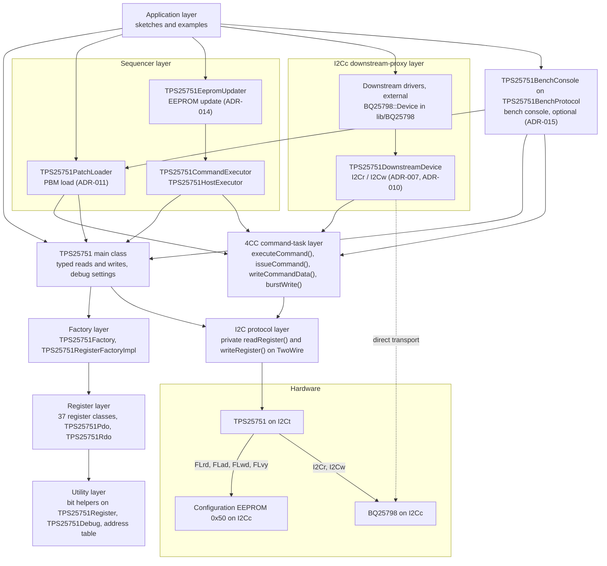
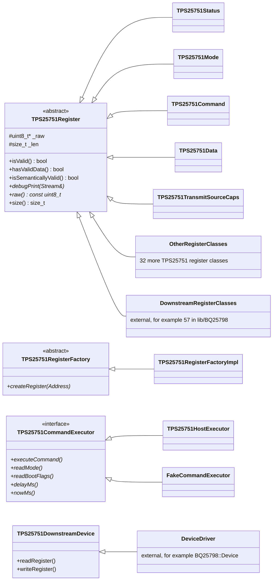
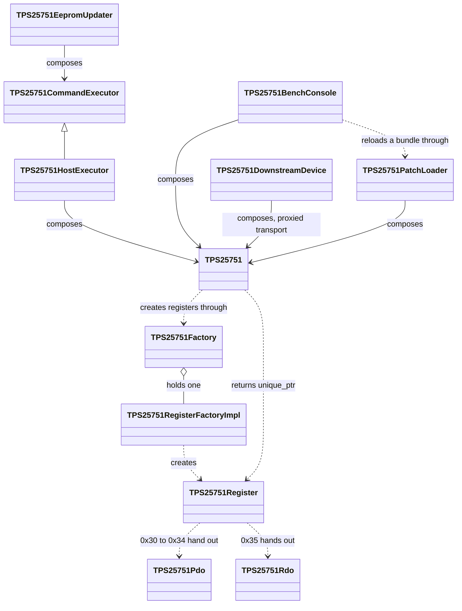
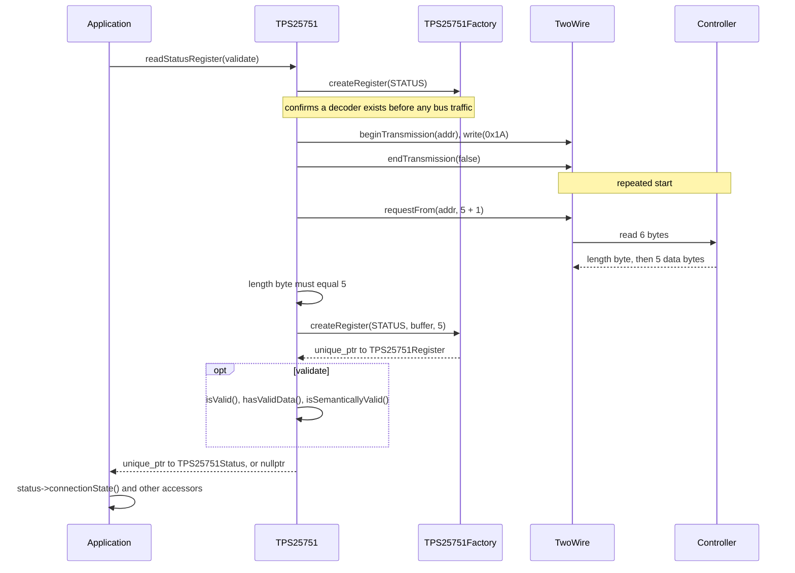
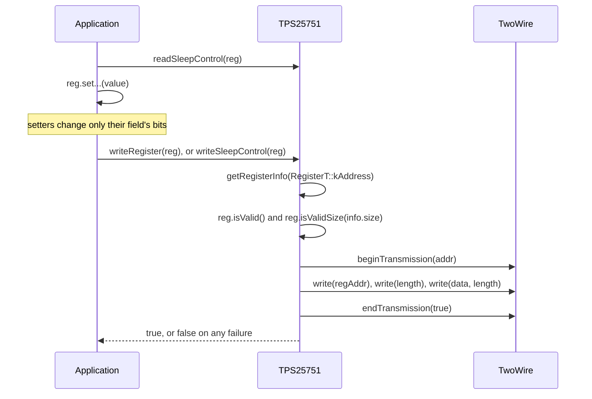
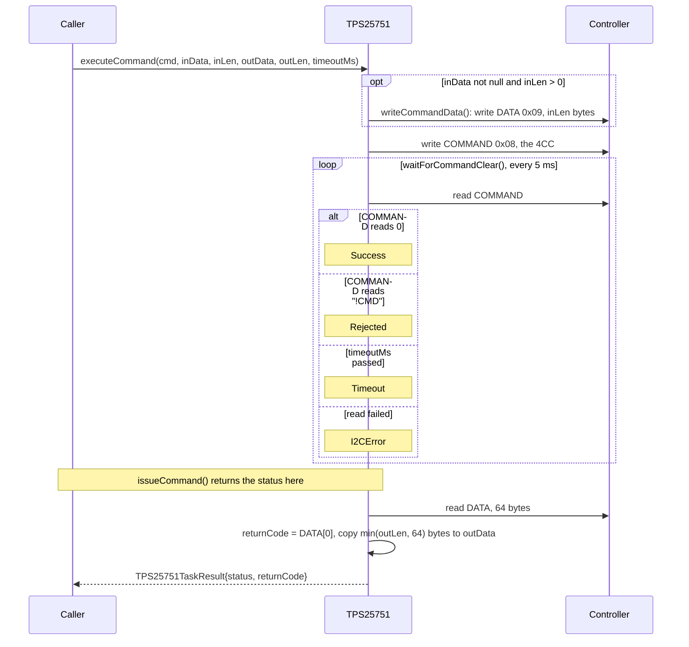
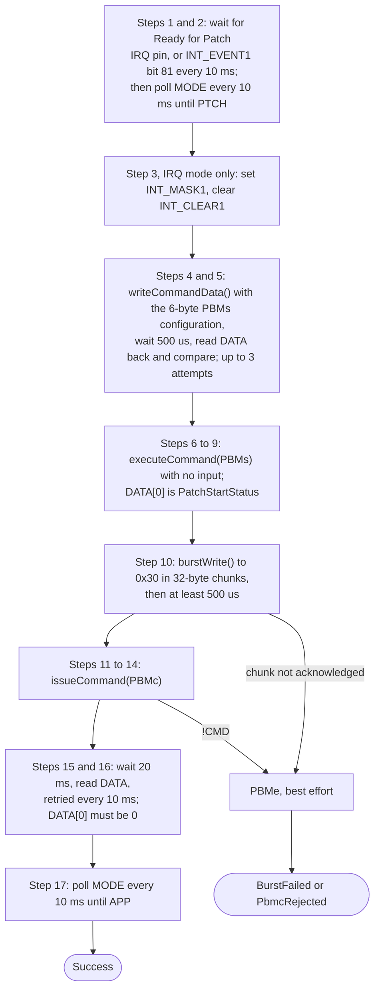
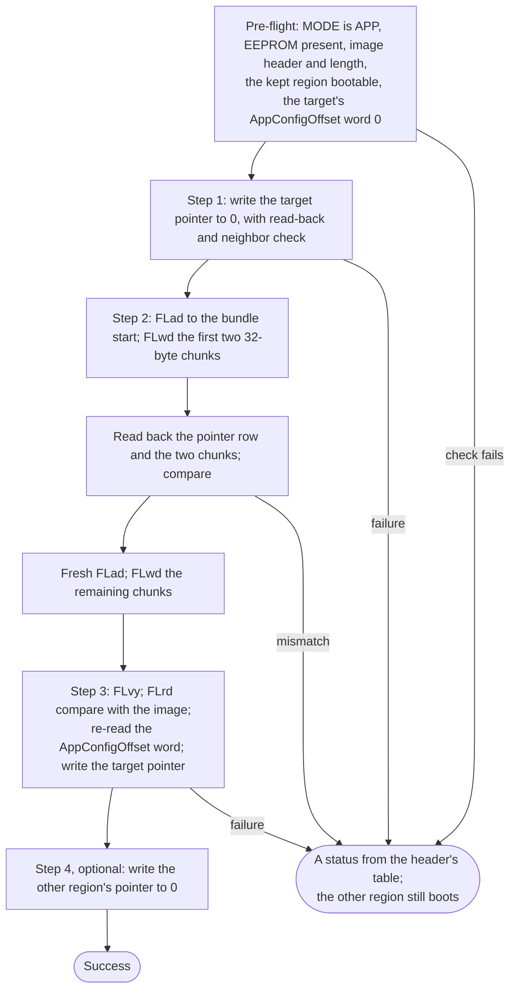
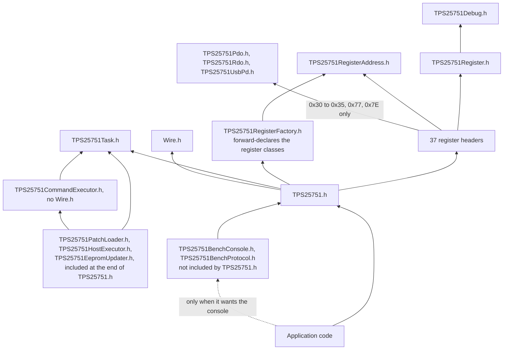

# TPS25751 library: system architecture

This document describes the library's layers, how its classes relate, how data moves
through them, and why the structure is the way it is. The headers in `include/` are the
API reference, so this document does not reproduce class declarations. Class and method
names in the Mermaid diagrams match the headers.

## System Overview

### High-Level Architecture

The application talks to one `TPS25751` object, or to a sequencer or downstream device
built on it. Everything that touches the bus goes through the `TPS25751` class's private
length-prefixed register transactions on a `TwoWire`, except the PBM burst, which
`burstWrite()` sends to I2C address 0x30. Devices on the controller's I2Cc bus, the
configuration EEPROM and the BQ25798 charger, are reached only through 4CC tasks that the
controller runs.

Solid arrows are calls or bus transactions; the dotted arrow is the optional direct
transport of ADR-010, which talks to a part on the MCU's own bus without the controller.
The 4CC layer is a set of methods on `TPS25751`, not a separate class; the diagram draws
it apart because three other components depend on it alone.

### Layer Responsibilities

#### Application layer

- User sketches and the four bundled examples: `read-registers`, `load-patch-bundle`,
  `eeprom-update`, and `pd-bench` (see `examples/README.md`).
- USB-C PD policy and any behavior specific to the product.

#### Main class (`TPS25751`)

- Owns the `TwoWire&` and the 7-bit I2Ct address (0x20 to 0x23, `TPS25751_I2CT_ADDRESS_IDX`).
- Typed reads in two forms: `read<Name>Register(bool validate = true)` returns a
  `std::unique_ptr` to the register class, or `nullptr` on a failed read or failed
  validation, and `read<Name>(T&)` fills a caller-owned object. All 37 registers have
  both. `readRegisterAs<T>(Address)` is the generic equivalent of the first form.
- One typed write per writable register (`writeSleepControl()`,
  `writeTransmitSourceCaps()`, and so on), plus the generic `writeRegister<T>(const T&)`
  keyed on the class's `kAddress`.
- Generic access by address: `readRegisterByAddress()`, `readRegisterAs<T>()`, and the
  `readRegister()` and `writeRegister()` overloads that take an `Address` or a
  `RegisterInfo`. `readRegisterRaw()` reads any address and returns the length byte the
  controller sent instead of comparing it with an expected size.
- Debug configuration: `setDebugStream()`, `setDebugLevel()`, `setDebugCategories()`.
- Every method is `const`: the object holds only the bus reference and the address, and
  all device state lives in the controller.
- Errors are reported through `TPS_REPORT_I2C_ERROR` and `TPS_DEBUG_*` and returned as
  `false` or `nullptr`. The class does not retry; callers that need a retry, such as the
  patch loader's MODE poll, implement it.

#### 4CC command-task layer

- `TPS25751::writeCommandData()` writes DATA (0x09) at the input's own length, 1 to 64
  bytes.
- `TPS25751::issueCommand()` writes DATA, writes the 4CC to COMMAND (0x08), and polls
  COMMAND every 5 ms until it clears, reads `"!CMD"`, or the timeout passes (default
  200 ms). It reads no DATA.
- `TPS25751::executeCommand()` is `issueCommand()` followed by a read of all 64 DATA bytes;
  DATA byte 0 is the task's return code (TRM SLVUCR8B, 4CC Task Detailed Descriptions).
- `TPS25751::burstWrite()` sends raw chunks to the PBM receive address, 0x30, with no
  register number and no length byte (ADR-011).
- `TPS25751Command` and `TPS25751Data` decode the two registers; `TPS25751Task.h` holds the
  value types `TPS25751FourCC`, `TPS25751TaskStatus`, and `TPS25751TaskResult`.

#### Sequencer layer

- `TPS25751PatchLoader` loads a firmware and configuration image into a controller in PTCH
  through Patch Burst Mode, following SLVAFV8A and TRM Figure 5-1 (ADR-011).
- `TPS25751EepromUpdater` reads, updates, and blank-programs the configuration EEPROM
  through the `FLrd`, `FLad`, `FLwd`, and `FLvy` tasks, following SLVAFL1 (ADR-014).
- `TPS25751CommandExecutor` is the five-call interface the updater depends on;
  `TPS25751HostExecutor` adapts a `TPS25751` to it, and the native tests use
  `FakeCommandExecutor`.
- Neither sequencer is a register: neither inherits `TPS25751Register` nor appears in the
  factory.

#### Bench console layer (optional)

- `TPS25751BenchProtocol` is the line protocol without I2C or a clock: the request parser,
  the `CMD` and `WR` allowlists, the snapshot register list, and the reply formatting.
  `TPS25751BenchLinePrefixer` is a `Stream` that turns a register's `debugPrint()` into
  reply lines.
- `TPS25751BenchConsole` binds the protocol to a `TPS25751&` and a `Stream&`. It runs
  tasks through `executeCommand()` and reloads a patch bundle through
  `TPS25751PatchLoader` (ADR-015).
- `TPS25751.h` does not include it. The host side is the MCP server in `tools/pd-bench`.

#### I2Cc downstream-proxy layer

- `TPS25751DownstreamDevice` reads and writes registers of a part on the controller's I2Cc
  bus through the `I2Cr` and `I2Cw` tasks, encoding their DATA payloads (ADR-007). A second
  constructor selects a direct transport on a `TwoWire` instead (ADR-010).
- It composes a `const TPS25751&`; it is not a `TPS25751` subclass.
- It warns through `DEBUG_CAT_TASK` when two `I2Cr` or two `I2Cw` commands come less than
  5 s apart, the TRM's minimum spacing, but does not block them.

#### Downstream device driver tier (external)

- Typed per-device drivers inherit `TPS25751DownstreamDevice`, keep their own namespace,
  `Address` enum, and factory, and reuse `TPS25751Register` as their decoder base
  (ADR-008, ADR-009).
- The reference implementation is the BQ25798 charger driver (`BQ25798::Device`, 57
  register classes) in the sibling `lib/BQ25798` repository. It depends on this library;
  nothing here depends on it.

#### Factory layer

- `TPS25751RegisterFactory` is the abstract factory; `TPS25751RegisterFactoryImpl` creates
  one class per `TPS25751Registers::Address` and returns `nullptr` for an address without
  a decoder.
- `TPS25751Factory` holds the process-wide instance, created on first use, and lets tests
  replace it through `setFactory()`. The library runs on one thread, so the lazy creation
  needs no lock.
- `TPS25751RegisterCreator::create()` is a free-function shorthand for the same calls.

#### Register layer

- 37 register classes, one per register in TRM SLVUCR8B. `include/AGENTS.md` indexes
  them, and each header documents its own register.
- Field accessors decode from the raw bytes; R/W classes add setters built on `setBits()`
  and a `static constexpr kAddress`.
- Three validation tiers: `isValid()`, `hasValidData()`, and `isSemanticallyValid()`
  (ADR-005).
- `debugPrint(Stream&)` in the format of `STANDARDS.md`.
- USB PD objects decode through value types rather than per-register getters:
  `TPS25751Pdo`, `TPS25751Rdo`, and the `TPS25751UsbPd` namespace of data-block enums
  (ADR-013).

#### I2C protocol layer

- The private `TPS25751::readRegister(uint8_t, uint8_t*, size_t)` and
  `TPS25751::writeRegister(uint8_t, const uint8_t*, size_t)`: the controller's
  length-prefixed protocol on the injected `TwoWire`. See the Data Flow section.
- Every other access path in the library ends in these two methods, except `burstWrite()`
  and the direct transport of `TPS25751DownstreamDevice`.

#### Utility layer

- Bitfield helpers on `TPS25751Register`: `extractBits*()`, `extractEnum*()`, `setBits()`,
  with a 16-bit bit position (ADR-012).
- `TPS25751Debug`: leveled, categorized logging with a compile-time ceiling.
- `TPS25751RegisterAddress.h`: the `Address` enum, the `RegisterInfo` size table, and
  `getRegisterInfo()` and `getRegisterSize()`.

## Class Hierarchy

### Inheritance Tree

`FakeCommandExecutor` lives in `test/support/native/` and is not part of the library.
Classes that inherit nothing: `TPS25751`, `TPS25751Factory`, `TPS25751PatchLoader`,
`TPS25751EepromUpdater`, `TPS25751BenchProtocol`, `TPS25751BenchConsole`, the value types
`TPS25751Pdo` and `TPS25751Rdo`, and the `TPS25751Task.h` structs.
`TPS25751BenchLinePrefixer` is a `Stream`.

`TPS25751Register` is a device-agnostic decoder base. Register classes for parts on the
I2Cc bus extend it exactly as host registers do. Each downstream device keeps its own
`Address` enum, `RegisterInfo` table, and factory, mirroring `TPS25751RegisterFactory` and
`TPS25751Factory`; the host factory is unaffected by them.

### Relationship Diagram

Composition everywhere above the main class: the sequencers, the downstream device, and
the bench console each hold a reference to the object they drive and never subclass it.

## Data Flow

### Register Read Flow

The controller answers a register read with a length byte followed by the data. The
library requests the register size plus one in a single read and checks the length byte
against the expected size.

A failed transaction, a short read, or a length byte that differs from the register size
ends the read with `TPS_REPORT_I2C_ERROR` and `nullptr`. The accessors decode through
`extractBits*()` on the object's own buffer and touch the bus no more.

### Register Write Flow

The write path sends the length byte instead of receiving it.

The other entry points join the same private `writeRegister(uint8_t, ...)`:
`writeRegister(Address, data, length)` first checks `length` against the register size
(0, an unknown address, skips the check), and `writeRegister(RegisterInfo, data)` takes the
size from the `RegisterInfo`. The library does not read a register back after writing it;
callers that need confirmation read it again, as the EEPROM updater does for its region
pointers.

### 4CC Command-Task Flow

`executeCommand()` is the generic executor (TRM SLVUCR8B, 4CC Task Detailed Descriptions).
`issueCommand()` is the same flow without the final DATA read, for a task whose DATA must
not be read at once (ADR-011 amendment of 2026-11-23).

DATA is written through `writeCommandData()` at the input's own length, not through the
public `writeRegister(Address, ...)`, which would require all 64 bytes. The executor knows
nothing about any task: `TPS25751DownstreamDevice`, `TPS25751PatchLoader`, and
`TPS25751HostExecutor` supply the payloads and unpack the results themselves, for example
I2Cr's read data, which starts at DATA byte 1 (CONSTRAINTS.md, 4CC Command Interface and
I2Cc Downstream-Device Proxy).

### Patch Load Flow

`TPS25751PatchLoader::loadPatchBundle()` loads an image into a controller in PTCH. The
step numbers are those of SLVAFV8A; `TPS25751PatchLoader.h` documents each, and ADR-011
records where the loader departs from TI's flow.

Every other failure returns its own `PatchLoadStatus` at the step where it happens.

### EEPROM Region Update Flow

`TPS25751EepromUpdater::updateRegion()` writes one region with the four steps of SLVAFL1
Figure 2-3, with a read-back added to step 2 (ADR-014). The header documents the state the
EEPROM is left in for every status.

`updateInactiveRegion()` picks the target with `selectTargetRegion()`, which reads the
region pointers first and BOOT_FLAGS only when both are valid. `updateBothRegions()` runs
the update twice, and `programBlank()` writes both AppConfigOffset words and then steps 1
to 3 for each region. `coldReset()` (`GAID`) is a separate call, so the application chooses
when the port disconnects.

### Downstream-Device Typed Write Flow (ADR-009)

The typed write tier of ADR-009 is a read-modify-write of a value object on the I2Cw
proxy: read the register through I2Cr, apply a field setter that changes only its own
bits, and write the whole buffer back through one I2Cw task (`len <= 11`,
`Length = payload + 1`; see ADR-007). The step-by-step walkthrough through the reference
implementation, `BQ25798::Device`, moved with the driver to the sibling `lib/BQ25798`
repository; see `docs/engineering/CONVENTIONS.md` there.

## Extension points

### Adding a register class

`STANDARDS.md` lists the reference classes to copy and every file a new register touches
(Wiring a new register in).

### Adding a Downstream Device Driver

The BQ25798 driver (`BQ25798::Device`, in the sibling `lib/BQ25798` repository) is the
reference implementation; follow its layout. A driver is a separate library that depends
on this one and needs no change to any TPS25751 host file.

1. Create `include/<Device>/` and `src/<Device>/` for the device's headers and sources, and
   use a `namespace <Device>` throughout.
2. Define `<Device>::Registers::Address` and a `RegisterInfo` table, mirroring
   `TPS25751Registers` and `TPS25751RegisterAddress.h`.
3. Implement one register class per register under `include/<Device>/`, each inheriting
   `TPS25751Register`, with the same template as host registers: a default constructor and
   a `(const uint8_t*, size_t)` constructor, the three validation tiers, and `debugPrint()`
   with `F()`. Keep read-only registers decode-only; for R/W registers add a
   `static constexpr Registers::Address kAddress` and field setters following ADR-009.
   - Assemble a 16-bit register of a big-endian device as `(raw[0] << 8) | raw[1]`, not
     with `extractBits16()`, which is little-endian and would swap the bytes.
   - Reinterpret a signed ADC channel's assembled `uint16_t` as `int16_t`.
   - Take ADC LSB sizes from the device datasheet; the register-docs server may not carry
     conversion factors.
4. Create `<Device>::RegisterFactory`, `RegisterFactoryImpl`, and `Factory`, with the same
   abstract interface and singleton as the host, switching on `<Device>::Registers::Address`
   and returning `nullptr` for an unknown address.
5. Create `<Device>::Device : public TPS25751DownstreamDevice` in
   `include/<Device>/<Device>Device.h`, with one typed `read<Register>()` per register
   through the inherited `readRegister<T>()`. For writable registers add a generic
   `writeRegister<T>()` keyed on `T::kAddress`, an `updateRegister<T>()` read-modify-write
   helper, and optional convenience setters (ADR-009). Forward the `(TwoWire&, addr)`
   constructor to get the direct transport (ADR-010).
6. Respect the TRM's 5 s minimum spacing between consecutive I2Cr, or consecutive I2Cw,
   commands. `TPS25751DownstreamDevice` warns through `DEBUG_CAT_TASK` but does not block.
7. Define the device for the register-docs MCP server under `devices/<device>/` in the
   sibling `lib/device-register-mcp-server` repository, point an entry in the driver repo's
   `.mcp.json` at it (`uv --directory ../device-register-mcp-server run server.py`), and add
   it to the MCP table in the driver repo's `AGENTS.md`.

## Compile-time dependencies

The sequencer headers forward-declare `TPS25751` and are included at the end of
`TPS25751.h`, so an application needs one `#include` and the headers have no include
cycle. `TPS25751CommandExecutor.h` does not include `Wire.h`, which is what lets the
updater build on the host. The bench console is the one header an application includes
separately, so firmware that does not use it does not compile it in.

## Memory ownership

The caller owns every register object the library returns, either in a `std::unique_ptr`
from `read<Name>Register()` and the factory, or as an object the caller passes to
`read<Name>(T&)`.

A register object owns its byte buffer (`uint8_t* _raw`, `size_t _len`), allocated with
`new[]` and freed in the destructor. `TPS25751` and the sequencers allocate nothing on the
heap for a transaction: their buffers, such as the 64-byte DATA image and the updater's
32-byte chunks, are on the stack. `readRegisterByAddress()` is the exception, with a
`std::make_unique<uint8_t[]>` scratch buffer that it frees on return.

The base class implements the Rule of Five. A move transfers `_raw` and leaves the source
empty (`isValid()` false); a copy allocates and copies. Register subclasses add no members
that own memory, so they use the base's copy and move operations and declare none of their
own.

## Test seams

`TESTING.md` describes the harness. These are the points where a test double replaces a
dependency:

| Seam | Test double | Location |
|---|---|---|
| `TwoWire` | A Wire fake with the Teensy driver's return codes and two targets: a scripted one, and a register table with hooks for the bench console | `test/support/native/Wire.h`, `FakeTps25751Target.h`, `FakeBenchTarget.h` |
| Arduino API | `millis()`, `delay()`, `micros()`, `Serial`, and `Stream` stubs with a controllable clock | `test/support/native/Arduino.h`, `Stream.h` |
| `Stream` | `FakeStream`, with input a test feeds and output it reads back | `test/support/native/FakeStream.h` |
| `TPS25751CommandExecutor` | `FakeCommandExecutor`, a modelled EEPROM with fault injection per task | `test/support/native/FakeCommandExecutor.h` |
| `TPS25751RegisterFactory` | Any subclass passed to `TPS25751Factory::setFactory()` | In the test |

`TPS25751DownstreamDevice.cpp` and `TPS25751HostExecutor.cpp` are not in the native build.

## Future Architecture Considerations

### Planned Enhancements

1. Interrupt-driven `executeCommand()` completion, deferred under ADR-007. An optional
   IRQ pin on `TPS25751` would let the executor wait for INT_EVENT1 bit 30 (Command 1
   Complete) instead of polling COMMAND, then read bit 82 (I2C Controller NACKed) and
   clear the event through INT_CLEAR1. `waitForCommandClear()` is a single private
   method so that a variant can replace it without touching DATA staging or any task's
   encoding. `TPS25751PatchLoader` already takes an IRQ pin for its Ready for Patch wait.
2. Additional platforms, ESP32 and RP2040 (not started).
3. Moving `TPS25751PatchLoader` and `TPS25751DownstreamDevice` onto the
   `TPS25751CommandExecutor` seam. The EEPROM-update plan lists it as out of scope; the
   loader already has native tests through the Wire fake, so the gain is smaller than it
   was.

### Ideas Not Scheduled

These have no plan or owner. Each would change a guarantee the library makes today, which
is that a read always reflects the device at the time of the call.

- A cache of frequently read registers, invalidated on write or interrupt.
- Non-blocking register reads with a completion callback.
- Change notification for subscribed registers.
- Saving and restoring a set of register values as a profile.

## Architectural decision records

### ADR-001 to ADR-006: early decisions

These six records predate the 4CC work. Each is one decision, stated here as built.

| ADR | Decision | As built |
|---|---|---|
| 001, 004 | Create registers through a factory, not a builder or direct construction | `TPS25751RegisterFactoryImpl` switches on `Address`; the builder is gone |
| 002, 005 | Three validation tiers: basic, data, semantic | The base class implements `isValid()` and `hasValidData()`; each register overrides only `isSemanticallyValid()` |
| 003 | Build with `-fno-rtti` | `static_cast` on an object whose address the caller chose; no `dynamic_cast` or `typeid` |
| 006 | Store register bytes in a `std::vector` | Not followed: the base holds `uint8_t* _raw` allocated with `new[]` and implements the copy and move operations. The record does not say when or why the decision changed |

### ADR-007: 4CC Command-Task Layer + I2Cc Downstream-Device Proxy
**Status:** Accepted
**Date:** 2026-06
**Context:** The TPS25751 exposes most functionality as directly-addressed
registers, but reaches devices on its secondary I2Cc bus (e.g. a BQ25798
charger) only through a generic "4CC" command-task interface (COMMAND/DATA,
TRM Sec 4.4.2) — write a payload to DATA, write a 4-character task code to
COMMAND, poll for completion, read results back from DATA. The **I2Cr**/**I2Cw**
tasks are this interface's read/write proxy to the I2Cc bus.
**Decision:**
- Add a generic, task-agnostic executor (`TPS25751::executeCommand()`) on the
  host, plus `TPS25751Command`/`TPS25751Data` register classes wired into the
  existing factory like the other 15 registers then implemented.
- Add `TPS25751DownstreamDevice` as a *separate, composed* abstraction (not a
  `TPS25751Register` subclass, not part of `TPS25751RegisterFactory`) that
  encodes/decodes the I2Cr/I2Cw DATA payloads on top of `executeCommand()`.
- Downstream device register classes reuse the existing `TPS25751Register`
  decoder base, so they look and behave like host-side registers from the
  caller's perspective, without requiring a second factory. (ADR-008 later gave
  each downstream device driver its own factory.)
- Completion detection is a busy-poll of COMMAND every 5 ms with a 200 ms default
  timeout (`waitForCommandClear()`); an interrupt-driven variant is deferred (see
  Planned Enhancements) because the TRM's 5-second inter-command spacing is a
  separate constraint an IRQ does not eliminate — so async polling is a
  latency/CPU optimization, not a correctness fix, and isn't worth the
  ISR/INT_EVENT1/INT_CLEAR1 complexity until the I2Cc path is proven on
  hardware.
**Consequences:**
- The 4CC layer is generic — any future task code (not just I2Cr/I2Cw) can
  reuse `executeCommand()` directly.
- `TPS25751DownstreamDevice` must itself enforce the TRM's 5-second minimum
  spacing between consecutive same-type (I2Cr or I2Cw) commands; this is host
  pacing the executor cannot see, since it operates one task at a time.
- Adding a downstream device is cheaper than adding a TPS25751 register (no
  factory wiring), at the cost of not benefiting from the host's factory
  validation/dispatch machinery.

### ADR-008: Downstream-Device Driver Tier (BQ25798)
**Status:** Accepted
**Date:** 2026-06
**Note (2026-07):** The reference implementation (`BQ25798::Device`) now lives in
the sibling **`lib/BQ25798`** repository as a separate library depending on this
one. This ADR remains here because it defines the *extension-point contract* any
downstream driver must follow; the split itself validated the contract (the driver
moved out with zero source edits).
**Context:** `TPS25751DownstreamDevice` provides raw I2Cr/I2Cw proxy access, but
callers need typed, validated register objects for the BQ25798 charger — without
coupling the host TPS25751 factory to a third-party device.
**Decision:**
- The typed driver **inherits** `TPS25751DownstreamDevice` (e.g. `BQ25798::Device`)
  rather than composing it, so the driver is itself the proxy with zero extra
  indirection.
- All driver code lives in a dedicated `namespace <Device>` with its own directories
  (`include/<Device>/`, `src/<Device>/`), fully decoupled from the host namespace.
- Each downstream device maintains its own `Address` enum, `RegisterInfo` table, and
  factory (`<Device>::RegisterFactory` / `RegisterFactoryImpl` / `Factory` singleton),
  **mirroring the host-side pattern exactly**. The host factory is not modified.
- Downstream device register classes reuse `TPS25751Register` as their decoder base —
  they look and behave identically to host-side registers from the caller's
  perspective. Read-only registers stay decode-only; R/W registers also carry field
  setters and a `kAddress` for the typed write tier (see ADR-009).
- Writes go through the inherited `TPS25751DownstreamDevice::writeRegister()`, or
  driver-specific setter methods that validate and encode before calling it.
**Consequences:**
- Adding a new downstream device is self-contained: new directories + namespace +
  factory, no changes to any TPS25751 host files.
- **Big-endian 16-bit registers**: downstream devices (e.g. BQ25798) store 16-bit
  fields big-endian; assemble as `(raw[0] << 8) | raw[1]`, not via
  `extractBits16` (which is little-endian and silently byte-swaps the value).
- **Signed ADC channels** (IBUS, IBAT, TDIE on BQ25798): assembled uint16_t must be
  reinterpreted as `int16_t` (2's complement); treating as unsigned gives wrong sign.
- **ADC LSB step sizes** must be sourced from the device datasheet (SLUSE02 for
  BQ25798); the MCP register definitions do not carry conversion factors.
- The BQ25798 implementation (57 registers, sibling `lib/BQ25798` repo) is the
  canonical reference for future downstream device drivers.

### ADR-009: Downstream-Device Write Encoders
**Status:** Accepted
**Date:** 2026-06
**Context:** ADR-008 established the decode (read) tier for downstream devices and
left field-level encoders deferred. Callers now need to *write* the ~31 R/W BQ25798
registers (charge/voltage/current limits, enables, watchdog, …) with the same typed,
field-level ergonomics as the read tier — without re-reading-and-clobbering reserved
or sibling bits.
**Decision:**
- **Read-modify-write value-object model.** A register object owns its raw bytes
  (`TPS25751Register::raw()` / `size()`, exposed on the base for this purpose). A field
  setter mutates only its field's bits in that buffer; everything else (reserved bits,
  sibling fields) is preserved by construction. The whole buffer is then written back.
- **Encode helpers** (`include/BQ25798/BQ25798Encode.h`, `lib/BQ25798` repo): `setField8()` and
  `setField16BE()` are the inverse of the decode-side extraction. They read-modify-write
  only the field's bits and mask the value to the field width. `setField16BE()` is
  **big-endian** (`raw[0]=MSB`), matching the read side's `(raw[0]<<8)|raw[1]`.
- **Generic typed write** — `Device::writeRegister<T>(const T&)` keys on the register's
  `static constexpr T::kAddress` (the single source of register identity) and sends
  `reg.raw()/reg.size()` through the inherited raw I2Cw path. A
  `using TPS25751DownstreamDevice::writeRegister;` keeps the inherited raw overload
  visible alongside the template.
- **`Device::updateRegister<T>(Fn&& mutate)`** — read `T` live, apply the mutator, write
  it back; one-call read-modify-write. The 10 L3 convenience setters
  (`enableCharging`, `setChargeCurrentLimit`, …) are thin `updateRegister<T>` wrappers.
- **Field setters invert the class's *own* decode constants.** An engineering-unit
  setter (e.g. `setMillivolts`) reuses the same `kLsbMv`/`kOffsetMv` the decode accessor
  uses, so encode and decode can never disagree. Offset conversions guard against
  unsigned underflow (clamp to 0 below the offset). Every setter is guarded
  `if (!isValid()) return;`.
**Consequences:**
- Reserved bits are preserved automatically — there is no separate "reassemble the whole
  register" step that could drop or zero them.
- Cross-references ADR-008 (decode tier): the same big-endian and own-constant rules now
  apply symmetrically on encode. The I2Cw framing constraints (`len ≤ 11`,
  `Length = payload + 1`) from ADR-007 are unchanged and apply to typed writes.
- Read-only registers (Status, Flags, ADC results, IcoCurrentLimit, PartInfo) get no
  `kAddress` and no setters, so they cannot be written by mistake.
- Canonical examples (sibling `lib/BQ25798` repo): `BQ25798ChargerControl0`
  (single-bit), `BQ25798ChargeVoltageLimit` (16-bit BE + unit inversion),
  `BQ25798MinimalSystemVoltage` (offset inversion with underflow guard).

### ADR-010: Dual-Transport Downstream Devices — Optional Direct I2C
**Status:** Accepted
**Date:** 2026-06
**Context:** `TPS25751DownstreamDevice` (and thus `BQ25798::Device`) could only reach a
part *through* the TPS25751, encoding every access as an I2Cr/I2Cw 4CC task (ADR-007).
That is correct for the production topology (charger on the TPS25751's I2Cc bus) but
unusable for bench bring-up, validation, or boards where the part is wired straight to
the MCU's own I2C bus. The TRM 5 s spacing and the 63-byte read / 11-byte write payload
caps are artifacts of the proxy path, not of the part.
**Decision:**
- **Transport is selected at construction, branched at one chokepoint.** A second
  constructor `TPS25751DownstreamDevice(TwoWire&, addr)` selects a **direct** transport;
  the existing `(const TPS25751&, addr)` constructor keeps the **proxied** transport. The
  host member becomes a nullable `const TPS25751*` and a `TwoWire*` is added; a `_direct`
  flag picks the path. The two raw methods `readRegister()` / `writeRegister()` branch to
  `readDirect`/`writeDirect` (plain Arduino-`Wire` register transactions) or
  `readProxied`/`writeProxied` (the unchanged I2Cr/I2Cw bodies).
- **Everything above the chokepoint is untouched.** All 50+ `BQ25798::Device` typed
  accessors, the generic `writeRegister<T>`/`updateRegister<T>`, and the L3 setters funnel
  through those two raw methods, so they work identically in either transport with no code
  change. `BQ25798::Device` just gains a forwarding `Device(TwoWire&, addr)` constructor.
- **Direct mode is standard I2C.** Read = write register pointer, repeated-start,
  burst-read N bytes (the part auto-increments its pointer); write = register pointer +
  payload + STOP. This is the part's own protocol, *not* the TPS25751's length-byte
  register protocol and *not* the 4CC task path.

**Consequences:**
- Direct mode has **no** TRM 5 s spacing and **no** 63/11-byte caps — the only bound is
  the `TwoWire` buffer. It requires the part to actually be on the passed bus.
- Any future downstream-device driver built on `TPS25751DownstreamDevice` inherits direct
  mode for free.
- The big-endian decode/encode conventions (ADR-008/009) are unchanged: burst reads/writes
  carry multi-byte registers identically over either transport.

### ADR-011: Patch Loader, a Non-Register PBM Sequencer on `executeCommand()`

Status: accepted, 2026-06; amended 2026-11-23 and 2026-11-24.

Context: a TPS25751 with no EEPROM boots in PTCH and takes its firmware and configuration
image over I2Ct through Patch Burst Mode (TI SLVAFV8A): the `PBMs` and `PBMc` tasks around
a raw burst to I2C address 0x30, which has no register number and no length byte.

Decision:

- `TPS25751PatchLoader` is a sequencer, not a register. PBM has no register layout, so
  the loader does not inherit `TPS25751Register` and is not in the factory. It composes a
  `TPS25751&`.
- The loader adds no task handshake of its own. It uses the core class's
  `executeCommand()`, and the core class gained three primitives for it: `burstWrite()`,
  the one bus access with no register framing; `issueCommand()`, the handshake without
  the DATA read; and `writeCommandData()`, an exact-length DATA write.
- `PBMc` goes through `issueCommand()`, and the loader waits 20 ms before it reads DATA.
  SLVAFV8A step 15 and TRM Figure 5-1 specify the wait. Without it, a read on hardware
  returned 28 of 65 bytes, the load reported `I2cError` although the patch had loaded,
  and every later read failed.
- The loader follows TRM Figure 5-1 where the two documents differ in detail: it polls
  for Ready for Patch and for PTCH, reads the `PBMs` configuration back before starting,
  and issues `PBMe` after a failed burst or a rejected `PBMc`.
- `PatchLoadStatus` has one value per failure point, so a caller learns which step
  failed. New values are appended so existing ones keep their numbers.
- The IRQ pin is optional. Command completion is always polled.

Consequences:

- The 0x30 passed to `burstWrite()` is an I2C device address. It shares its value with
  the register address of RECEIVED_SOURCE_CAPABILITIES and is unrelated to it.
- Both poll caps are 5000 ms, a choice the documents do not bound.
- `TPS25751.cpp` and the loader build in `[env:native]` against the TwoWire fake, and
  `test_TPS25751PatchLoader` pins the transaction order and the 20 ms.
- Fifteen loads on hardware succeeded with the amended sequence. Neither `PBMe` path has
  run on hardware.

The step-by-step flow, its timings, and where it departs from SLVAFV8A are in
`TPS25751PatchLoader.h` and CONSTRAINTS.md (Patch Burst Mode). The hardware stages are in
`docs/plans/feature/eeprom-update.md`.

### ADR-012: 16-Bit Bit Positions in the Register Base Class
**Status:** Accepted
**Date:** 2026-11-19
**Context:** `extractBits()`, `extractBits16/32/64()`, `setBits()`, and the `extractEnum*()`
templates took the field's bit position as `uint8_t`, so no field could start past bit 255
(byte 31). Seven registers are longer than 32 bytes. DATA (0x09) and the four capability
registers (0x30 to 0x33) reach their late bytes through byte accessors or hand-assembled PDO
words, and two registers with individually defined fields past bit 255 worked around the
limit on their own: IO_CONFIG (0x5C, 49 bytes, fields to bit 391) and
TX_BATTERY_CAPABILITIES (0x7D, 36 bytes, battery 3 at bits 287:216).
`TPS25751IOConfig` assembled every field from `_raw[]` by hand, and
`TPS25751TransmitBatteryCapabilities` carried four class-private, bounds-checked byte
helpers for reads and writes. Both copies repeated bounds logic the base class already
has, and every new long register would have added another.
**Decision:**
- Widen `bitPos` to `uint16_t` in every instance and static extract and set method and in
  the `extractEnum*()` templates. `bitLen` stays `uint8_t`, because no field is wider than
  64 bits.
- Do all internal byte arithmetic (start byte, bytes needed, loop indexes) in `size_t`, and
  compare the field's end against the buffer length in `size_t`, so no sum can wrap.
  `extractBits64()` computes the upper half's bit position in 32 bits and reads that half
  as 0 when the position does not fit, instead of letting it wrap to a low bit. Each half
  stays bounds-checked on its own, as before.
- Convert 0x7D and 0x5C to the base-class calls and delete their private helpers.
- `uint16_t` rather than `size_t`: 65,535 bits is 8 KB, far past the 64-byte DATA register,
  and it matches the existing `uint16_t startBitPos` of `extractArray32()`.
**Consequences:**
- Any field inside the buffer is reachable; the only limit is the register's length.
- The change is source-compatible. Callers pass integer literals or `uint8_t` values, which
  convert implicitly, including the sibling BQ25798 driver, which calls the protected
  helpers. A derived class that declares its own `extractBits(uint8_t, uint8_t)` overload
  would now overload rather than hide the base method; no class in this repository or in
  BQ25798 does.
- Decode results do not change. Native tests cover fields at bit 255, past it, and
  straddling it, and a byte-for-byte comparison of `debugPrint()` for all 37 registers
  matched before and after.
- The PDO accessors of the capability registers (0x30 to 0x33) still assemble their 32-bit
  words from `_raw[]` by hand. They are correct and were left as they are; they could move
  to `extractBits32()` and `setBits()` in a later cleanup.

### ADR-013: USB PD Objects as Value Types
**Status:** Accepted
**Date:** 2026-11-22
**Context:** Registers 0x30 to 0x35 carry USB PD PDO and RDO words. Each class decoded
them with its own getters (`getFixedVoltage_mV(i)`, `fixedUnconstrainedPower()`,
`operatingCurrent_mA()`, and so on), so five copies of the PDO decode drifted apart and
shared the same faults: fixed-PDO flags read from any position although Table 6.10
reserves them outside PDO 1, no decode of the SPR AVS APDO the board itself
advertises, every RDO read as Fixed/Variable whatever the contract, and per-class
validation rules that disagreed with the specification.
**Decision:**
- One value type per object: `TPS25751Pdo` (a PDO word, its 1-based position, and the
  role of its sender) and `TPS25751Rdo` (an RDO word and its `RdoKind`). Both decode
  from USB PD R3.3 V1.0 tables served by `usb-pd-docs`, return 0 or false for a field
  that does not apply, and print themselves.
- The register classes hand them out: `pdo(i)` in 0x30 to 0x33, `activePdo()` and
  `firstPdoControl()` in 0x34, `ownRdo(kind)` and `requestedRdo(kind)` in 0x35. The
  per-class field getters are removed.
- An RDO's kind is not in the word. The caller derives it with `rdoKindFor(pdo)` from
  the PDO at the RDO's Object Position, and 0x35 offers a `debugPrint()` overload that
  takes both kinds.
- `validatePdoList()` validates a whole Capabilities list once, with the received or
  transmit rule set, so a list rule (PDO 1 is vSafe5V, the PDO order, AVS currents
  matching the Fixed PDOs) has one implementation.
**Consequences:**
- A breaking API change in 3.0.0: the per-class PDO and RDO getters are gone, and
  0x34's raw accessors are renamed `rawActivePdo()` and `rawFirstPdoControlBits()`.
- Decoding a new PDO or RDO layout, or changing a rule, is a change to one file and
  one suite (`test_TPS25751Pdo`, `test_TPS25751Rdo`).
- 0x30 to 0x34 validation follows USB PD R3.3 (received lists reject only what a
  receiver must; transmit lists also enforce the sender rules), which accepts some
  values the old rules rejected (zero currents) and rejects some they accepted (a PDO
  1 at 4.9 V, an over-range current).
- 0x35 cannot decode its typed fields alone; its single-argument `debugPrint()` prints
  the raw words and common fields with a note that the typed fields need the PDO type.

### ADR-014: EEPROM Updater, a Non-Register Flash-Task Sequencer on an Executor Seam

Status: accepted, 2026-11-23.

Context: the controller boots its patch bundle from an EEPROM at 0x50 on I2Cc, which a
host can rewrite only through the flash tasks `FLrd`, `FLad`, `FLwd`, and `FLvy` while
the controller runs in APP. TI SLVAFL1 defines two regions and a four-step update. An
ordering error can leave no bootable region, and recovery then needs a PBM load (ADR-011)
or an external programmer. The sequencing therefore needs host tests that inject a fault
at every task.

Decision:

- `TPS25751EepromUpdater` is a sequencer, not a register, beside `TPS25751PatchLoader`.
- It depends on `TPS25751CommandExecutor`, an interface of five calls that does not
  include `Wire.h`. `TPS25751HostExecutor` adapts a `TPS25751` on the target, and the
  native tests use `FakeCommandExecutor`. The seam stays although `TPS25751.cpp` now
  builds natively, because a fake executor models the EEPROM far more simply than a fake
  bus. Virtual calls need no RTTI.
- A region counts as bootable only if its pointer equals its bundle start and its
  AppConfigOffset word reads 0, because the controller looks for the Header_ID at the
  region start plus that word (SLVAFL1 page 2). An update refuses unless the kept region
  is bootable and the target's word is 0.
- Region selection reads the region pointers first and BOOT_FLAGS only when both are
  valid. BOOT_FLAGS is latched at boot, so after an update without a restart SLVAFL1
  Figure 2-2, which decides from BOOT_FLAGS alone, would select and erase the only valid
  region.
- The written region is compared with the image through `FLrd` before its pointer is
  written. `FLvy` is not enough: the TRM says it completes after the header check, and
  SLVAFL1 says a CRC error in a Low region with a correct header ends the boot without
  trying High, so a valid Low pointer over a damaged Low body costs both regions.
- Step 2 reads back the first two chunks and the target pointer row before writing the
  rest, then sends a fresh `FLad`. An `FLad` that reported success without taking effect,
  which no TI document describes, then misplaces 64 bytes instead of a whole bundle.
- `coldReset()` is a separate call, so the application decides when the port
  disconnects. It returns `Success` only after it saw the controller go away, because
  MODE reads APP both before and after a restart.
- `programBlank()` writes both AppConfigOffset words first, then each region, Low first,
  and refuses while any pointer is valid.

Consequences:

- The updater builds in `[env:native]`. Its suite sweeps an executor failure and a wrong
  return code across every task and asserts the EEPROM state the header's status table
  promises.
- `FakeCommandExecutor` models behaviour the TRM does not state. A test that depends on
  such a choice pins the fake, not the device; the fake labels each one.
- The read-back has limits, listed in `TPS25751EepromUpdater.h`: the `FLad` after it is
  not verified, and chunks misplaced outside the pointer row go unseen when the target
  already held the image.
- A region update blocks for about 26 s and both regions for about 52 s. An application
  with a watchdog services it from the progress callback.
- Hardware stages 1 to 10 ran every call, including a power cut after each step of an
  update. Not shown on hardware: a cut inside a pointer write or an EEPROM write cycle,
  and the refusals for a nonzero AppConfigOffset word.

The task rules and timings are in CONSTRAINTS.md (Flash tasks and EEPROM update), the
state the EEPROM is left in for every status is in `TPS25751EepromUpdater.h`, and the
stage results are in `docs/plans/feature/eeprom-update.md`.

### ADR-015: Bench Console, an Optional Layer over the Controller Class

Status: accepted, 2026-11-23.

Context: checking the library against a USB PD analyzer needs a host program that reads
registers as raw bytes, runs 4CC tasks, and restarts the controller, without new firmware
for each experiment. Downstream firmware needs the same access without flashing this
library's example.

Decision:

- Two classes, neither a register. `TPS25751BenchProtocol` holds the line protocol's
  parser, the task and write allowlists, and the reply formatting, with no I2C and no
  clock. `TPS25751BenchConsole` binds it to a `TPS25751&` and a `Stream&` and runs from
  `poll()` in `loop()`.
- `TPS25751.h` does not include the console, so firmware that leaves it out does not
  compile it in.
- Default deny. `CMD` runs only the tasks on the allowlist, and `WR` writes only 0x27,
  0x28, 0x29, 0x37, and 0x42, as a whole register. 0x29 joined on 2026-11-25 so the bench
  can keep a sourcing board from swapping to sink: bit 5 (Initiate Swap to Sink) makes it
  send PR_Swap and bit 4 (Process Swap to Sink) makes it accept one. A 0x29 write takes effect
  at the next policy event and does not disconnect the port, unlike 0x27 and 0x28. The role swaps need
  `-D TPS25751_BENCH_ALLOW_SWAPS`. The patch tasks, `GO2P`, the flash tasks, and `I2Cw`
  are always refused.
- The console adds no I2C code. Every task goes through `TPS25751::executeCommand()`, and
  a patch reload through `TPS25751PatchLoader::loadPatchBundle()`.
- One new core primitive, `TPS25751::readRegisterRaw()`. Every other read fails unless the
  controller's length byte equals the size the caller expects, and none returns the byte.
  The snapshot format stores the length byte as read, and `RD` must work for an address
  the library has no size for. For such an address the console first asks for one byte to
  learn the length, which the TRM permits (SLVUCR8B section 1.3.1, page 9).
- A restart is confirmed, not assumed. `Gaid` and `GAID` never complete as tasks (SLVUCR8B
  page 62), so the console writes a marker to DATA, issues the task, and waits until
  COMMAND reads clear and one of three observations shows the restart: DATA lost the
  marker, the controller stopped answering for a while, or COMMAND held the task code and
  then cleared. A COMMAND write that was not acknowledged, and a `!CMD` that arrives
  after the issue window, each end the wait at once with their own error.
- Answering is not being ready. On hardware COMMAND and DATA read 30 ms after a warm
  restart, while MODE gave nothing for several seconds and the port attached a second
  time. After a restart the console therefore polls MODE every 50 ms, for up to 10 s,
  until it reads APP or PTCH, and takes read errors, an empty MODE, and BOOT as "not yet".
- One read of PTCH does not start a patch load, because a controller with an EEPROM reads
  PTCH on its way to APP. The console gives the controller 3 s to reach APP; PTCH with
  INT_EVENT1 Ready for Patch ends that wait early. The loader then makes its own Ready
  for Patch and MODE checks (ADR-011) and sends nothing without them. `GAID` is refused up
  front when BOOT_FLAGS says the configuration did not come from an EEPROM and no bundle
  is set.
- Reading commands only read. `HELLO`, `RD`, and `DEC` change nothing, so a host can mark
  them read-only. Only `begin()` and `RESTART` load the patch bundle; `HELLO` reports
  `mode=PTCH` and `patch_pending=1` instead.
- Whole reply lines. Every I2C access of a command happens before the reply line that
  reports it starts. The library can print an I2C error on its debug stream, and when
  that stream is the console's, the report then lands between reply lines.

Consequences:

- The protocol is versioned: `HELLO` reports `proto=1`, and the host server in
  `tools/pd-bench` refuses another version. Both come from the same library tag.
- A command runs to completion inside `poll()`. A restart with a patch reload blocks
  `loop()` for several seconds, which is acceptable on a bench and should be weighed
  before the console goes into production firmware.
- The console suite runs the real `TPS25751` class and the real patch loader against
  `FakeBenchTarget`, a second target behind the Wire fake (TESTING.md, Bench console
  tests).
- The library version is not available to the sources. `HELLO` reports
  `TPS25751_LIBRARY_VERSION` when the build defines it, as the example's pre-script does
  from `library.json`, and `unknown` otherwise.

The protocol, the allowlists, and the restart sequence are in `TPS25751BenchProtocol.h`,
`TPS25751BenchConsole.h`, and `tools/pd-bench/README.md`.
